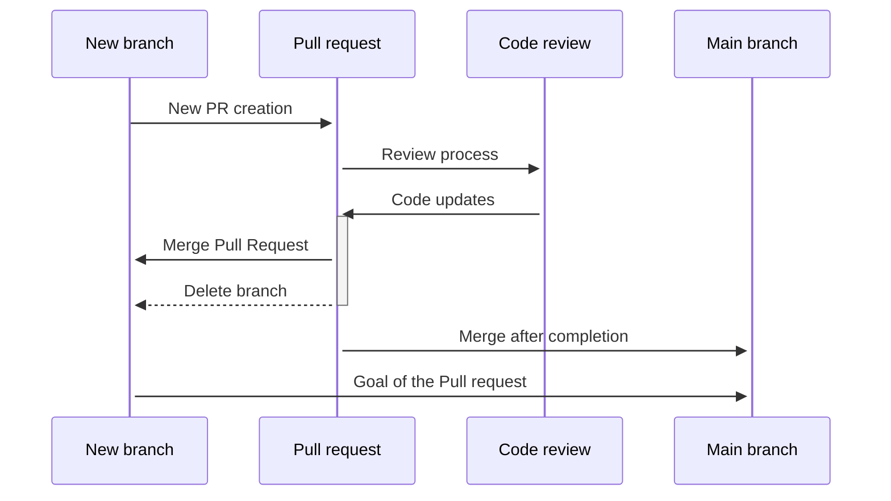

<!-- file: docs/automated-testing/README.md -->

# Testing

## Why Testing

- Tests allow us to find flaws in our software
- Good tests document the code by describing the intent
- Automated tests saves time, compared to manual tests
- Automated tests allow us to safely change and refactor our code without introducing regressions

## The Fundamentals

- We consider code to be incomplete if it is not accompanied by tests
- We write unit tests (tests without external dependencies) that can run before every PR merge to validate that we don’t have regressions
- We write Integration tests/E2E tests that test the whole system end to end, and run them regularly
- We write our tests early and block any further code merging if tests fail.
- We run load tests/performance tests where appropriate to validate that the system performs under stress

## Build for Testing

Testing is a critical part of the development process.  It is important to build your application with testing in mind.  Here are some tips to help you build for testing:

- **Parameterize everything.** Rather than hard-code any variables, consider making everything a configurable parameter with a reasonable default. This will allow you to easily change the behavior of your application during testing. Particularly during performance testing, it is common to test different values to see what impact that has on performance. If a range of defaults need to change together, consider one or more parameters which set "modes", changing the defaults of a group of parameters together.

- **Document at startup.** When your application starts up, it should log all parameters. This ensures the person reviewing the logs and application behavior know exactly how the application is configured.

- **Log to console.** Logging to external systems like Azure Monitor is desirable for traceability across services. This requires logs to be dispatched from the local system to the external system and that is a dependency that can fail. It is important that someone be able to console logs directly on the local system.

- **Log to external system.** In addition to console logs, logging to an external system like Azure Monitor is desirable for traceability across services and durability of logs.

- **Log all activity.** If the system is performing some activity (reading data from a database, calling an external service, etc.), it should log that activity. Ideally, there should be a log message saying the activity is starting and another log message saying the activity is complete. This allows someone reviewing the logs to understand what the application is doing and how long it is taking. Depending on how noisy this is, different messages can be associated with different log levels, but it is important to have the information available when it comes to debugging a deployed system.

- **Correlate distributed activities.** If the system is performing some activity that is distributed across multiple systems, it is important to correlate the activity across those systems. This can be done using a Correlation ID that is passed from system to system. This allows someone reviewing the logs to understand the entire flow of activity. For more information, please see [Observability in Microservices](../observability/microservices.md).

- **Log metadata.** When logging, it is important to include metadata that is relevant to the activity. For example, a Tenant ID, Customer ID, or Order ID. This allows someone reviewing the logs to understand the context of the activity and filter to a manageable set of logs.

- **Log performance metrics.** Even if you are using App Insights to capture how long dependency calls are taking, it is often useful to know how long certain functions of your application took. It then becomes possible to evaluate the performance characteristics of your application as it is deployed on different compute platforms with different limitations on CPU, memory, and network bandwidth. For more information, please see [Metrics](../observability/pillars/metrics.md).


## Map of Outcomes to Testing Techniques

The table below maps outcomes (the results that you may want to achieve in your validation efforts) to one or more techniques that can be used to accomplish that outcome.

| When I am working on... | I want to get this outcome... | ...so I should consider |
| -- | -- | -- |
| Development | Prove backward compatibility with existing callers and clients | [Shadow testing](./shadow-testing/README.md) |
| Development | Ensure telemetry is sufficiently detailed and complete to trace and diagnose malfunction in [End-to-End testing](./e2e-testing/README.md) flows | Distributed Debug challenges; Orphaned call chain analysis |
| Development | Ensure program logic is correct for a variety of expected, mainline, edge and unexpected inputs | [Unit testing](./unit-testing/README.md); Functional tests; [Consumer-driven Contract Testing](./cdc-testing/README.md); [Integration testing](./integration-testing/README.md) |
| Development | Prevent regressions in logical correctness; earlier is better | [Unit testing](./unit-testing/README.md); Functional tests; [Consumer-driven Contract Testing](./cdc-testing/README.md); [Integration testing](./integration-testing/README.md); Rings (each of these are expanding scopes of coverage) |
| Development | Quickly validate mainline correctness of a point of functionality (e.g. single API), manually | Manual smoke testing Tools: postman, powershell, curl |
| Development | Validate interactions between components in isolation, ensuring that consumer and provider components are compatible and conform to a shared understanding documented in a contract | [Consumer-driven Contract Testing](./cdc-testing/README.md) |
| Development | Validate that multiple components function together across multiple interfaces in a call chain, incl network hops | [Integration testing](./integration-testing/README.md); End-to-end ([End-to-End testing](./e2e-testing/README.md)) tests; Segmented end-to-end ([End-to-End testing](./e2e-testing/README.md)) |
| Development | Prove disaster recoverability – recover from corruption of data | DR drills |
| Development | Find vulnerabilities in service Authentication or Authorization | Scenario (security) |
| Development | Prove correct RBAC and claims interpretation of Authorization code | Scenario (security) |
| Development | Document and/or enforce valid API usage | [Unit testing](./unit-testing/README.md); Functional tests; [Consumer-driven Contract Testing](./cdc-testing/README.md) |
| Development | Prove implementation correctness in advance of a dependency or absent a dependency | [Unit testing](./unit-testing/README.md) (with mocks); [Unit testing](./unit-testing/README.md) (with emulators); [Consumer-driven Contract Testing](./cdc-testing/README.md) |
| Development | Ensure that the user interface is accessible | [Accessibility](../non-functional-requirements/accessibility.md) |
| Development | Ensure that users can operate the interface | [UI testing (automated)](./ui-testing/README.md) (human usability observation) |
| Development | Prevent regression in user experience | UI automation; [End-to-End testing](./e2e-testing/README.md) |
| Development | Detect and prevent 'noisy neighbor' phenomena | [Load testing](./performance-testing/load-testing.md) |
| Development | Detect availability drops | [Synthetic Transaction testing](./synthetic-monitoring-tests/README.md); Outside-in probes |
| Development | Prevent regression in 'composite' scenario use cases / workflows (e.g. an e-commerce system might have many APIs that used together in a sequence perform a "shop-and-buy" scenario) | [End-to-End testing](./e2e-testing/README.md); Scenario |
| Development; Operations | Prevent regressions in runtime performance metrics e.g. latency / cost / resource consumption; earlier is better | Rings; [Synthetic Transaction testing](./synthetic-monitoring-tests/README.md) / Transaction; Rollback Watchdogs |
| Development; Optimization | Compare any given metric between 2 candidate implementations or variations in functionality | Flighting; A/B testing |
| Development; Staging | Prove production system of provisioned capacity meets goals for reliability, availability, resource consumption, performance | [Load testing (stress)](./performance-testing/load-testing.md); Spike; Soak; [Performance testing](./performance-testing/README.md) |
| Development; Staging | Understand key user experience performance characteristics – latency, chattiness, resiliency to network errors | Load; [Performance testing](./performance-testing/README.md); Scenario (network partitioning) |
| Development; Staging; Operation | Discover melt points (the loads at which failure or maximum tolerable resource consumption occurs) for each individual component in the stack | Squeeze; [Load testing (stress)](./performance-testing/load-testing.md) |
| Development; Staging; Operation | Discover overall system melt point (the loads at which the end-to-end system fails) and which component is the weakest link in the whole stack | Squeeze; [Load testing (stress)](./performance-testing/load-testing.md) |
| Development; Staging; Operation | Measure capacity limits for given provisioning to predict or satisfy future provisioning needs | Squeeze; [Load testing (stress)](./performance-testing/load-testing.md) |
| Development; Staging; Operation | Create / exercise failover runbook | Failover drills |
| Development; Staging; Operation | Prove disaster recoverability – loss of data center (the meteor scenario); measure MTTR | DR drills |
| Development; Staging; Operation | Understand whether observability dashboards are correct, and telemetry is complete; flowing  | Trace Validation; [Load testing (stress)](./performance-testing/load-testing.md); Scenario; [End-to-End testing](./e2e-testing/README.md) |
| Development; Staging; Operation | Measure impact of seasonality of traffic  | [Load testing](./performance-testing/load-testing.md) |
| Development; Staging; Operation | Prove Transaction and alerts correctly notify / take action  | [Synthetic Transaction testing](./synthetic-monitoring-tests/README.md) (negative cases); [Load testing](./performance-testing/load-testing.md) |
| Development; Staging; Operation; Optimizing | Understand scalability curve, i.e. how the system consumes resources with load | [Load testing (stress)](./performance-testing/load-testing.md); [Performance testing](./performance-testing/README.md)  |
| Operation; Optimizing | Discover system behavior over long-haul time | Soak  |
| Optimizing | Find cost savings opportunities  | Squeeze |
| Staging; Operation | Measure impact of failover / scale-out (repartitioning, increasing provisioning) / scale-down | Failover drills; Scale drills |
| Staging; Operation | Create/Exercise runbook for increasing/reducing provisioning | Scale drills |
| Staging; Operation | Measure behavior under rapid changes in traffic | Spike |
| Staging; Optimizing | Discover cost metrics per unit load volume (what factors influence cost at what load points, e.g. cost per million concurrent users) | Load (stress) |
| Development; Operation | Discover points where a system is not resilient to unpredictable yet inevitable failures (network outage, hardware failure, VM host servicing, rack/switch failures, random acts of the Malevolent Divine, solar flares, sharks that eat undersea cable relays, cosmic radiation, power outages, renegade backhoe operators, wolves chewing on junction boxes, …) | Chaos |
| Development | Perform unit testing on Power platform custom connectors | [Custom Connector Testing](./unit-testing/custom-connector.md) |

## Technology Specific Testing

- [Using DevTest Pattern for building containers with AzDO](./tech-specific-samples/building-containers-with-azure-devops.md)
- [Using Azurite to run blob storage tests in pipeline](./tech-specific-samples/blobstorage-unit-tests/README.md)

<!-- file: docs/automated-testing/test-planning.md -->

# Test planning

We should be intentional when we think about how to test our applications. One way to make sure that we are testing the right things is to build test plans for various scenarios and work out test cases at the design stage of a user story.

This content aims to show some ways we can think about planning and give some examples using a web site with a login portal as an example.

## Building test cases for a user story

As we design the code for a user story we can start by defining a set of test cases that will ensure that all acceptance criteria are met.

This can be done as an exercise that includes both the developers and other stakeholders. Some of the test cases may initially be manual, and some may be planned for automation, depending on the situation.

Going through this exercise doesn't only produce test cases, it also helps clarify the acceptance criteria and informs how we should build the solution.

1. Understand the Acceptance Criteria
    - Thoroughly read and understand the acceptance criteria for the story
    - Clarify any ambiguities with the product owner or stake holders

2. Identify Test Scenarios
    - Consider both positive and negative scenarios (happy paths, and error cases) to cover edge cases
    - Determine what is in and out of scope, i.e. do we only test functional requirements, or are non-functional requirements such as security, accessibility, reliability etc. in scope for testing?

3. Define Test Cases
    - For each test scenario, define detailed test cases
    - Each test case should be documented with
        - **TestCase Title:** What is being tested
        - **Preconditions:** Any setup or test data required before executing the test
        - **Test Steps:** Step-by-step instructions to execute the test
        - **Expected Result:** The expected outcome of the test

    The test can be described in the Given-When-Then format to make it clear and concise:

    **Given** the initial context or state, **When** the action or event, **Then** the precise outcome

4. Automate where Possible
    - If feasible, automate the test cases
    - Focus on automating hot paths, and critical areas

5. Review and Refine
    - Review the test cases with peers or stakeholders to ensure that we have covered everything we want to cover, and that expected outcomes are correct
    - Refine the test cases based on feedback

### Examples of Test Cases using the Given-When-Then Format

| User Login | (Positive Test Case) |
| -- | -- |
| **Title** | Verify user login with valid credentials |
| **Preconditions** | User is on the login page |
| **Test Steps** | **Given** the user is on the login page **When** the user enters valid credentials and clicks the login button **Then** the user should be redirected to the dashboard |
| **Expected Result** | User is successfully logged in and redirected to the dashboard |

| User Login with Invalid Credentials | (Negative Test Case) |
| -- | -- |
| **Title** | Verify user login with invalid credentials |
| **Preconditions** | User is on the login page |
| **Test Steps** | **Given** the user is on the login page **When** the user enters invalid credentials and clicks the login button **Then** the user should se an error message indicating invalid username or password |
| **Expected Result** | Error message is displayed and the user remains on the login page |

| Security Testing for Login Page | (Non-Functional Requirement) |
| -- | -- |
| **Title** | Verify that the login page is protected against SQL injection attacks |
| **Preconditions** | User is on the login page |
| **Test Steps** | **Given** the user is on the login page **When** the user enters a SQL injection string (e.g. ' OR '1'=1) in the username field and clicks the login button **Then** the system should not allow login and should display an error message |
| **Expected Result** | The system prevents login and displays an error message |

| Usability Testing for Form Validation | (Non-Functional Requirement) |
| -- | -- |
| **Title** | Verify that the registration form provides clear error messages for invalid inputs |
| **Preconditions** | User is on the registration page |
| **Test Steps** | **Given** the user is on the registration page **When** the user enters invalid data (e.g. incorrect email format) and submits the form **Then** the system should display a clear and specific error message indicating the issue |
| **Expected Result** | Clear and specific error message is displayed |

| Reliability Testing for System Uptime | (Non-Functional Requirement) |
| -- | -- |
| **Title** | Verify that the system maintains 99.9% uptime over a month |
| **Preconditions** | System is monitored over a month |
| **Test Steps** | **Given** the system is up and running **When** the system is monitored for uptime over a month **Then** the system should maintain 99.9% uptime |
| **Expected Result** | System maintains 99.9% uptime over the monitored period |

## Grouping Test Cases into Test Plans

We can create different test plans, such as a full regression test plan, a smoke test plan, a functional test plan etc. and organize the test cases under these test plans.

A few benefits of creating test plans are:

- We can make sure that all aspects of the application are tested, including functional, non-functional and edge cases
- They provide clear objectives and scope, which helps developers understand what needs to be tested
- They help manage and execute tests systematically, i.e. we have a suite of tests to run validate integration etc.
- By identifying and prioritizing test cases based on risk, test plans help us focus on the most critical areas of the application.
- In some industries they are required for compliance with standards and regulation.
- They help us understand what tests are most important to automate

### Common Test Plans

Here are some examples of test plans we may want to create for our systems:

#### Full Regression Test plan

**Purpose:** To verify that recent changes have not adversely affected existing functionality
**Test Cases Included:**

- All functional test cases
- All integration test cases
- All system test cases
- All previously reported bugs that have been fixed

**Example:**

- Test001: Verify user login with valid credentials
- Test002: Verify user registration with valid details
- Test003: Verify password reset functionality

#### Smoke Test plan

**Purpose:** To perform a quick check to ensure that the most critical functionalities of the application are working
**Test Cases Included:**

- Basic functionality test cases
- High-priority test cases that cover the core features

**Example:**

- Test001: Verify user login with valid credentials
- Test004: Verify adding an item to the shopping cart
- Test005: Verify search functionality with a valid keyword

#### Functional Test Plan

**Purpose:** To verify that each function of the software application conforms to the specification
**Test Cases Included:**

- Test cases that validate specific functionality
- Test cases that cover user interactions and business logic

**Example:**

- Test002: Verify user registration with valid details
- Test006: Verify user login with invalid credentials
- Test005: Verify user registration with missing requirement fields

#### Area Regression Test Plan

**Purpose:** To verify that changes in a specific area of the application have not affected other parts of the application
**Test Cases Included:**

- Test cases related to the specific area where changes were made
- Test cases that cover the integration points of the affected area

**Example:** If changes were made to the user profile model

- Test008: Verify password reset functionality with an invalid email address
- Test009: Verify updating user profile information
- Test010: Verify changing user password

### Other Test Plan Examples

Here are some additional examples of test plans:

#### Integration Test Plan

To verify that different modules or services of the application work together as expected

- Test cases that validate the interaction between different modules
- Test cases that check data flow between integrated components

#### User Acceptance Test (UAT) Plan

To ensure the system meets the business requirements and is ready for production use

- Test cases based on real-world scenarios and user stories
- Test cases that validate end-to-end business processes

#### Load Test Plan

To determine how the system performs under heavy load conditions

- Test cases that simulate high user traffic
- Test cases that measure response times and system behavior under load

#### Security Test Plan

To identify and mitigate security vulnerabilities in the application

- Test cases that check for common security issues like SQL injection, XSS, and CSRF
- Test cases that validate user authentication and authorization mechanisms

#### Compatibility Test Plan

To ensure the application works across different devices, browsers, and operating systems

- Test cases that validate functionality on various devices and browsers
- Test cases that check for consistent user experiences across platforms

#### Recovery Test Plan

To verify the system's ability to recover from crashes, hardware failures, or other catastrophic problems

- Test cases that simulate system failures and recovery processes
- Test cases that validate data integrity after recovery

#### Localization Test Plan

To ensure the application is correctly adapted for different languages and regions

- Test cases that validate language translations
- Test cases that check for region specific content

### How to Group Test Cases into a Test Plan

1. **Identify the Scope:** Determine the scope of each test plan based on testing objectives
2. **Select Relevant Test Cases:** Chose test cases that align with the scope and objectives of each test plan
3. **Organize Test Cases:** Group the selected test cases into the respective test plans
4. **Review and Validate:** Review the grouped test cases to ensure they cover all necessary aspects and validate them with stakeholders if needed
5. **Document the Test Plans:** Clearly document each test plan, including the purpose, scope, and list of test cases

## Resources

- [The One Page Test Plan](https://www.ministryoftesting.com/articles/the-one-page-test-plan)
- [One-Page Test Plan | Write your Plan in Minutes](https://www.youtube.com/watch?v=BYN6AFhR4GE)

<!-- file: docs/automated-testing/unit-testing/README.md -->

# Unit Testing

Unit testing is a fundamental tool in every developer's toolbox. Unit tests not only help us test our code, they
encourage good design practices, reduce the chances of bugs reaching production, and can even serve as examples or
documentation on how code functions. Properly written unit tests can also improve developer efficiency.

Unit testing also is one of the most commonly misunderstood forms of testing. Unit testing refers to a very specific
type of testing; a unit test should be:

- **Provably reliable** - should be 100% reliable so failures indicate a bug in the code
- **Fast** - should run in milliseconds, a whole unit testing suite shouldn't take longer than a couple seconds
- **Isolated** - removing all external dependencies ensures reliability and speed

## Why Unit Testing

It is no secret that writing unit tests is hard, and even harder to write well. Writing unit tests also increases the
development time for every feature. So why should we write them?

Unit tests

- reduce costs by catching bugs earlier and preventing regressions
- increase developer confidence in changes
- speed up the developer inner loop
- act as documentation as code

For more details, see all the [detailed descriptions of the points above](./why-unit-tests.md).

## Unit Testing Design Blocks

Unit testing is the lowest level of testing and as such generally has few components and dependencies.

The **system under test** (abbreviated SUT) is the "unit" we are testing. Generally these are methods or functions, but
depending on the language these could be different. In general, you want the unit to be as small as possible though.

Most languages also have a wide suite of **unit testing frameworks** and test runners. These test frameworks have
a wide range of functionality, but the base functionality should be a way to organize your tests and run them quickly.

Finally, there is your **unit test code**; unit test code is generally short and simple, preferring repetition to adding
layers and complexity to the code.

## Applying the Unit Testing

Getting started with writing a unit test is much easier than some other test types since it should require next to no
setup and is just code. Each [test framework](#test-frameworks) is different in how you organize and write your tests,
but the general techniques and best practices of writing a unit test are universal.

### Techniques

These are some commonly used techniques that will help when authoring unit tests. For some examples, see the pages on
using [abstraction and dependency injection to author a unit test](./authoring-example.md), or how to do [test-driven development](./tdd-example.md).

Note that some of these techniques are more specific to strongly typed, object-oriented languages. Functional languages
and scripting languages have similar techniques that may look different, but these terms are commonly used in all unit
testing examples.

#### Abstraction

Abstraction is when we take an exact implementation detail, and we generalize it into a concept instead. This technique
can be used in creating testable design and is used often especially in object-oriented languages. For unit tests,
abstraction is commonly used to break a hard dependency and replace it with an abstraction. That abstraction then allows
for greater flexibility in the code and allows for the a [mock or simulator](./mocking.md) to be used in its place.

One of the side effects of abstracting dependencies is that you may have an abstraction that has no test coverage. This
is case where unit testing is not well-suited, you can not expect to unit test everything, things like dependencies will
always be an uncovered case. This is why even if you have a robust unit testing suite, [integration or functional testing](../integration-testing/README.md)
should still be used - without that, a change in the way the dependency functions would never be caught.

When building wrappers around third-party dependencies, it is best to keep the implementations with as little logic as
possible, using a very simple [facade](https://en.wikipedia.org/wiki/Facade_pattern) that calls the dependency.

An example of using abstraction can be found [here](./authoring-example.md#abstraction).

#### Dependency Injection

[Dependency injection](https://en.wikipedia.org/wiki/Dependency_injection) is a technique which allows us to extract
dependencies from our code. In a normal use-case of a dependant class, the dependency is constructed and used within the
system under test. This creates a hard dependency between the two classes, which can make it particularly hard to test
in isolation. Dependencies could be things like classes wrapping a REST API, or even something as simple as file access.
By injecting the dependencies into our system rather than constructing them, we have "inverted control" of the
dependency. You may see "Inversion of Control" and "Dependency Injection" used as separate terms, but it is very hard to
have one and not the other, with some arguing that [Dependency Injection is a more specific way of saying inversion of
control](https://martinfowler.com/articles/injection.html#InversionOfControl). In certain languages such as C#, not using
dependency injection can lead to code that is not unit testable since there is no way to inject mocked objects.
Keeping testability in mind from the beginning and evaluating using dependency injection can save you from a time-intensive
refactor later.

One of the [downsides of dependency injection](https://en.wikipedia.org/wiki/Dependency_injection#Disadvantages) is that
it can easily go overboard. While there are no longer hard dependencies, there is still coupling between the interfaces,
and passing around every interface implementation into every class presents just as many downsides as not using
Dependency Injection. Being intentional with what dependencies get injected to what classes, is key to developing a maintainable
system.

Many languages include special Dependency Injection frameworks that take care of the boilerplate code and construction
of the objects. Examples of this are [Spring](https://spring.io/) in Java or built into [ASP.NET Core](https://learn.microsoft.com/en-us/aspnet/core/fundamentals/dependency-injection?view=aspnetcore-3.1)

An example of using dependency injection can be found [here](./authoring-example.md#dependency-injection).

#### Test-Driven Development

Test-Driven Development (TDD) is a technique for writing your code that will lead you to a testable design from the start. 
The basic premise of test-driven development is that you come up with a list behaviors you want your system to have.  
You then take one behavior from the list, write the test, and then modify the system to make the test pass.  
Then you move on to the next behavior on your list and repeat this process.
Once you've exhausted your list, you're done!  This approach has the benefit of guaranteeing a testable design is built into 
the system since the test was written first.

For more information on TDD and an example, see the page on [Test-Driven Development](./tdd-example.md)

### Best Practices

#### Arrange/Act/Assert

One common form of organizing your unit test code is called Arrange/Act/Assert. This divides up your unit test into 3
different discrete sections:

1. Arrange - Set up all the variables, mocks, interfaces, and state you will need to run the test
2. Act - Run the system under test, passing in any of the above objects that were created
3. Assert - Check that with the given state that the system acted appropriately.

Using this pattern to write tests makes them very readable and also familiar to future developers who would need to read
your unit tests.

##### Example

Let's assume we have a class `MyObject` with a method `TrySomething` that interacts with an array of strings, but if the
array has no elements, it will return false. We want to write a test that checks the case where array has no elements:

```csharp
[Fact]
public void TrySomething_NoElements_ReturnsFalse()
{
    // Arrange
    var elements = Array.Empty<string>();
    var myObject = new MyObject();

    // Act
    var myReturn = myObject.TrySomething(elements);

    // Assert
    Assert.False(myReturn);
}
```

#### Keep Tests Small and Test Only One Thing

Unit tests should be short and test only one thing. This makes it easy to diagnose when there was a failure without
needing something like which line number the test failed at. When using [Arrange/Act/Assert](#arrangeactassert), think
of it like testing just one thing in the "Act" phase.

There is some disagreement on whether testing one thing means "assert one thing" or "test one state, with
multiple asserts if needed". Both have their advantages and disadvantages, but as with most technical disagreements
there is no "right" answer. Consistency when writing your tests one way or the other is more important!

#### Using a Standard Naming Convention for All Unit Tests

Without having a set standard convention for unit test names, unit test names end up being either not descriptive
enough, or duplicated across multiple different test classes. Establishing a standard is not only important for keeping
your code consistent, but a good standard also improves the readability and debug-ability of a test. In this article,
the convention used for all unit tests has been `UnitName_StateUnderTest_ExpectedResult`, but there are lots of other
possible conventions as well, the important thing is to be consistent and descriptive. Having descriptive names such as
the one above makes it trivial to find the test when there is a failure, and also already explains what the expectation
of the test was and what state caused it to fail. This can be especially helpful when looking at failures in a CI/CD
system where all you know is the name of the test that failed - instead now you know the name of the test and exactly
why it failed (especially coupled with a test framework that logs helpful output on failures).

### Things to Avoid

Some common pitfalls when writing a unit test that are important to avoid:

- Sleeps - A sleep can be an indicator that perhaps something is making a request to a dependency that it should not be.
  In general, if your code is flaky without the sleep, consider why it is failing and if you can remove the flakiness by
  introducing a more reliable way to communicate potential state changes. Adding sleeps to your unit tests also breaks
  one of our original tenets of unit testing: tests should be fast, as in order of milliseconds. If tests are taking on
  the order of seconds, they become more cumbersome to run.
- Reading from disk - It can be really tempting to the expected value of a function return in a file and read that file
  to compare the results. This creates a dependency with the system drive, and it breaks our tenet of keeping our unit
  tests isolated and 100% reliable. Any outside dependency such as file system access could potentially cause
  intermittent failures. Additionally, this could be a sign that perhaps the test or unit under test is too complex and
  should be simplified.
- Calling third-party APIs - When you do not control a third-party library that you are calling into, it's impossible to
  know for sure what that is doing, and it is best to abstract it out. Otherwise, you may be making REST calls or other
  potential areas of failure without directly writing the code for it. This is also generally a sign that the design of
  the system is not entirely testable. It is best to wrap third party API calls in interfaces or other structures so
  that they do not get invoked in unit tests. For more information see the page on [mocking](mocking.md).

## Unit Testing Frameworks and Tools

### Test Frameworks

Unit test frameworks are constantly changing. For a full list of every unit testing framework [see the page on
Wikipedia](https://en.wikipedia.org/wiki/List_of_unit_testing_frameworks). Frameworks have many features and
should be picked based on which feature-set fits best for the particular project.

### Mock Frameworks

Many projects start with both a unit test framework, and also add a mock framework. While mocking frameworks have their
uses and sometimes can be a requirement, it should not be something that is added without considering the broader
implications and risks associated with heavy usage of mocks.

To see if mocking is right for your project, or if a mock-free approach is more appropriate, see the page on [mocking](./mocking.md).

### Tools

These tools allow for constant running of your unit tests with in-line code coverage, making the dev inner loop
extremely fast and allows for easy TDD:

- [Visual Studio Live Unit Testing](https://learn.microsoft.com/en-us/visualstudio/test/live-unit-testing-intro?view=vs-2019)
- [Wallaby.js](https://wallabyjs.com/)
- [Infinitest](http://infinitest.github.io/) for Java
- [PyCrunch](https://plugins.jetbrains.com/plugin/13264-pycrunch--live-testing) for Python

## Things to Consider

### Transferring Responsibility to Integration Tests

In some situations it is worth considering to include the integration tests in the inner development loop to provide a sufficient code coverage to ensure the system is working properly. The prerequisite for this approach to be successful is to have integration tests being able to execute at a speed comparable to that of unit tests both locally and in a CI environment. Modern application frameworks like .NET or Spring Boot combined with the right mocking or stubbing approach for external dependencies offer excellent capabilities to enable such scenarios for testing.

Usually, integration tests only prove that independently developed modules connect together as designed. The test coverage of integration tests can be extended to verify the correct behavior of the system as well. The responsibility of providing a sufficient branch and line code coverage can be transferred from unit tests to integration tests.
Instead of several unit tests needed to test a specific case of functionality of the system, one integration scenario is created that covers the entire flow. For example in case of an API, the received HTTP responses and their content are verified for each request in test. This covers both the integration between components of the API and the correctness of its business logic.

With this approach efficient integration tests can be treated as an extension of unit testing, taking over the responsibility of validating happy/failure path scenarios. It has the advantage of testing the system as a black box without any knowledge of its internals. Code refactoring has no impact on tests. Common testing techniques as TDD can be applied at a higher level which results in a development process that is driven by acceptance tests. Depending on the project specifics unit tests still play an important role. They can be used to help dictate a testable design at a lower level or to test complex business logic and corner cases if necessary.

## Conclusion

Unit testing is extremely important, but it is also not the silver bullet; having proper unit tests is just a part of a
well-tested system. However, writing proper unit tests will help with the design of your system as well as help catch
regressions, bugs, and increase developer velocity.

## Resources

- [Unit Testing Best Practices](https://learn.microsoft.com/en-us/dotnet/core/testing/unit-testing-best-practices)

<!-- file: docs/automated-testing/unit-testing/why-unit-tests.md -->

# Why Unit Tests

It is no secret that writing unit tests is hard, and even harder to write well. Writing unit tests also increases the
development time for every feature. So why should we bother writing them?

## Reduce Costs

There is no question that the later a bug is found, the more expensive it is to fix; especially so if the bug makes it
into production. A [2008 research study by IBM](ftp://ftp.software.ibm.com/software/rational/info/do-more/RAW14109USEN.pdf)
estimates that a bug caught in production could cost 6 times as much as if it was caught during implementation.

## Increase Developer Confidence

Many changes that developers make are not big features or something that requires an entire testing suite. A strong unit
test suite helps increase the confidence of the developer that their change is not going to cause any downstream bugs.
Having unit tests also helps with making safe, mechanical refactors that are provably safe; using things like
refactoring tools to do mechanical refactoring and running unit tests that cover the refactored code should be enough to
increase confidence in the commit.

## Speed Up Development

Unit tests take time to write, but they also speed up development? While this may seem like an oxymoron, it is one of
the strengths of a unit testing suite - over time it continues to grow and evolve until the tests become an essential
part of the developer workflow.

If the only testing available to a developer is a long-running system test, integration tests that require a deployment,
or manual testing, it will increase the amount of time taken to write a feature. These types of tests should be a part of
the "Outer loop"; tests that may take some time to run and validate more than just the code you are writing. Usually
these types of outer loop tests get run at the PR stage or even later during merges into branches.

The Developer Inner Loop is the process that developers go through as they are authoring code. This varies from
developer to developer and language to language but typically is something like code -> build -> run -> repeat. When
unit tests are inserted into the inner loop, developers can get early feedback and results from the code they are
writing. Since unit tests execute really quickly, running tests shouldn't be seen as a barrier to entry for this loop.
Tooling such as [Visual Studio Live Unit Testing](https://learn.microsoft.com/en-us/visualstudio/test/live-unit-testing-start?view=vs-2019)
also help to shorten the inner loop even more.

## Documentation as Code

Writing unit tests is a great way to show how the units of code you are writing are supposed to be used. In some ways,
unit tests are better than any documentation or samples because they are (or at least should be) executed with every
build so there is confidence that they are not out of date. Unit tests also should be so simple that they are easy to follow.

<!-- file: docs/automated-testing/unit-testing/tdd-example.md -->

# Test-Driven Development Example

With this method, rather than writing all your tests up front, you write one test at a time and then switch to write the
system code that would make that test pass. It's important to write the bare minimum of code necessary even if it is not
actually "correct". Once the test passes you can refactor the code to make it maybe make more sense, but again the logic
should be simple. As you write more tests, the logic gets more and more complex, but you can continue to make the
minimal changes to the system code with confidence because all code that was written is covered.

As an example, let's assume we are trying to write a new function that validates a string is a valid password format.
The password format should be a string larger than 8 characters containing at least one number. We start with the
simplest possible test; one of the easiest ways to do this is to first write tests that validate inputs into the
function:

```csharp
// Tests.cs
public class Tests
{
    [Fact]
    public void ValidatePassword_NullInput_Throws()
    {
        var s = new MyClass();
        Assert.Throws<ArgumentNullException>(() => s.ValidatePassword(null));
    }
}

// MyClass.cs
public class MyClass
{
    public bool ValidatePassword(string input)
    {
        return false;
    }
}
```

If we run this code, the test will fail as no exception was thrown since our code in `ValidateString` is just a stub.
This is ok! This is the "Red" part of Red-Green-Refactor. Now we want to move onto the "Green" part - making the minimal
change required to make this test pass:

```csharp
// MyClass.cs
public class MyClass
{
    public bool ValidatePassword(string input)
    {
        throw new ArgumentNullException(nameof(input));
    }
}
```

Our tests pass, but this function doesn't really work, it will always throw the exception. That's ok! As we
continue to write tests we will slowly add the logic for this function, and it will build on itself, all while
guaranteeing our tests continue to pass.

We will skip the "Refactor" stage at this point because there isn't anything to refactor. Next let's add a test that
checks that the function returns false if the password is less than size 8:

```csharp
[Fact]
public void ValidatePassword_SmallSize_ReturnsFalse()
{
    var s = new MyClass();
    Assert.False(s.ValidatePassword("abc"));
}
```

This test will pass as it still only throws an `ArgumentNullException`, but again, that is an expected failure. Fixing
our function should see it pass:

```csharp
public bool ValidatePassword(string input)
{
    if (input == null)
    {
        throw new ArgumentNullException(nameof(input));
    }

    return false;
}
```

Finally, some code that looks real! Note how it wasn't the test that checked for null that had us add the `if` statement
for the null-check, but rather the subsequent test which unlocked a whole new branch. By adding that if statement, we
made the bare minimum change necessary in order to get **both** tests to pass, but we still have work to do.

In general, working in the order of adding a negative test first before adding a positive test will ensure that both
cases get covered by the code in a way that can get tests. Red-Green-Refactor makes that process super easy by requiring
the bare minimum change - since we only want to make the bare minimum changes, we just simply return false here, knowing
full well that we will be adding logic later that will expand on this.

Speaking of which, let's add the positive test now:

```csharp
[Fact]
public void ValidatePassword_RightSize_ReturnsTrue()
{
    var s = new MyClass();
    Assert.True(s.ValidatePassword("abcdefgh1"));
}
```

Again, this test will fail at the start. One thing to note here if that its important that we try and make our tests
resilient to future changes. When we write the code under test, we act very naively, only trying to make the current
tests we have pass; when you write tests though, you want to ensure that everything you are doing is a valid case in the
future. In this case, we could have written the input string as `abcdefgh` and when we eventually write the function it
would pass, but later when we add tests that validate the function has the rest of the proper inputs it would fail
incorrectly.

Anyways, the next code change is:

```csharp
public bool ValidatePassword(string input)
{
    if (input == null)
    {
        throw new ArgumentNullException(nameof(input));
    }

    if (input.Length > 8)
    {
        return true;
    }
    return false;
}
```

Here we now have a passing test! However, the logic doesn't actually make much sense. We did the bare minimum
change which was adding a new condition that passed for longer strings, but thinking forward we know this
won't work as soon as we add additional validations. So let's use our first "Refactor" step in the Red-Green-Refactor flow!

```csharp
public bool ValidatePassword(string input)
{
    if (input == null)
    {
        throw new ArgumentNullException(nameof(input));
    }

    if (input.Length < 8)
    {
        return false;
    }
    return true;
}
```

That looks better. Note how from a functional perspective, inverting the if-statement does not change what the function returns.
This is an important part of the refactor flow, maintaining the logic by doing provably safe refactors, usually through the use of tooling and automated refactors from
your IDE.

Finally, we have one last requirement for our `ValidatePassword` method and that is that it needs to check that there is
a number in the password. Let's again start with the negative test and validate that with a string with the valid length
that the function returns `false` if we do not pass in a number:

```csharp
[Fact]
public void ValidatePassword_ValidLength_ReturnsFalse()
{
    var s = new MyClass();
    Assert.False(s.ValidatePassword("abcdefghij"));
}
```

Of course the test fails as it is only checking length requirements. Let's fix the method to check for numbers:

```csharp
public bool ValidatePassword(string input)
{
    if (input == null)
    {
        throw new ArgumentNullException(nameof(input));
    }

    if (input.Length < 8)
    {
        return false;
    }

    if (!input.Any(char.IsDigit))
    {
        return false;
    }
    return true;
}
```

Here we use a handy LINQ method to check if any of the `char`s in the `string` are a digit, and if not, return false.
Tests now pass, and we can refactor. For readability, why not combine the `if` statements:

```csharp
public bool ValidatePassword(string input)
{
    if (input == null)
    {
        throw new ArgumentNullException(nameof(input));
    }

    if ((input.Length < 8) ||
        (!input.Any(char.IsDigit)))
    {
        return false;
    }

    return true;
}
```

As we refactor this code, we feel 100% confident in the changes we made as we have 100% test coverage which tests both
positive and negative scenarios. In this case we actually already have a method that tests the positive case, so our function is done!

Now that our code is completely tested we can make all sorts of changes and still have confidence that it works. For
example, if we wanted to change the implementation of the method to use regex, all of our tests would still pass and
still be valid.

That is it! We finished writing our function, we have 100% test coverage, and if we had done something a little more
complex, we are guaranteed that whatever we designed is already testable since the tests were written first!

<!-- file: docs/automated-testing/unit-testing/mocking.md -->

# Mocking in Unit Tests

One of the key components of writing unit tests is to remove the dependencies your system has and replacing it with an
implementation you control. The most common method people use as the replacement for the dependency is a mock, and
mocking frameworks exist to help make this process easier.

Many frameworks and articles use different meanings for the differences between test doubles. A test double is a generic
term for any "pretend" object used in place of a real one. This term, as well as others used in this page are the
[definitions provided by Martin Fowler](https://martinfowler.com/articles/mocksArentStubs.html#TheDifferenceBetweenMocksAndStubs).
The most commonly used form of test double is Mocks, but there are many cases where Mocks perhaps are not the best
choice and Fakes should be considered instead.

## Stubs

Stub allows you to have predetermined behavior that substitutes real behavior.
The dependency (abstract class or interface) is implemented as a stub with a logic as expected by the client.
Stubs can be useful when the clients of the stubs all expect the same set of responses, e.g. you use a third party service.
The key concept here is that stubs should never fail a unit or integration test where a mock can.
Stubs do not require any sort of framework to run, but are usually supported by mocking frameworks to quickly build the stubs.
Stubs are commonly used in combination with a dependency injection frameworks or libraries, where the real object is replaced by a stub implementation.

Stubs can be useful especially during early development of a system, but since nearly every test requires its own stubs
(to test the different states), this quickly becomes repetitive and involves a lot of boilerplate code. Rarely will you
find a codebase that uses only stubs for mocking, they are usually paired with other test doubles.

Stubs do not require any sort of framework to run, but are usually supported by mocking frameworks to quickly build the
stubs.

```python
# Python test example, that creates an application
# with a dependency injection framework an overrides
# a service with a stub

class StubTestCase(TestBase):
    def setUp(self) -> None:
        super(StubTestCase, self).setUp()
        self.app.container.service_a.override(StubService())

    def test_service():
        service = self.app.container.service_a()
        self.assertTrue(isinstance(service, StubService))

```

### Upsides

- Do not require any framework, easy to set up.

### Downsides

- Can involve rewriting the same code many times, lots of boilerplate.

## Mocks

Fowler describes **mocks** as pre-programmed objects with expectations which form a specification of the calls they are
expected to receive. In other words, mocks are a replacement object for the dependency that has certain expectations
that are placed on it; those expectations might be things like validating a sub-method has been called a certain number
of times or that arguments are passed down in a certain way.

Mocking frameworks are abundant for every language, with some languages having mocks built into the unit test packages.
They make writing unit tests easy and still encourage good unit testing practices.

The main difference between a mock and most of the other test doubles is that mocks do **behavioral verification**,
whereas other test doubles do **state verification**. With behavioral verification, you end up testing that the
implementation of the system under test is as you expect, whereas with state verification the implementation is not
tested, rather the inputs and the outputs to the system are validated.

The major downside to behavioral verification is that it is tied to the implementation. One of the biggest advantages of
writing unit tests is that when you make code changes you have confidence that if your unit tests continue to pass, that
you are making a relatively safe change. If tests need to be updated every time because the behavior of the method has
changed, then you lose that confidence because bugs could also be introduced into the test code. This also increases the
development time and can be a source of frustration.

For example, let's assume you have a method that you are testing that makes 5 web service calls. With mocks, one of your
tests could be to check that those 5 web service calls were made. Sometime later the API is updated and only a single
web service call needs to be made. Once the system code is changed, the unit test will fail because it expects 5 calls
and not 1. The test needs to be updated, which results in lowered confidence in the change, as well as potentially
introduces more areas for bugs to sneak in.

Some would argue that in the example above, the unit test is not a good test anyway because it depends on the
implementation, and that may be true; but one of the biggest problems with using mocks (and specifically mocking
frameworks that allow these verifications), is that it encourages these types of tests to be written. By not using a
mock framework that allows this, you never run the risk of writing tests that are validating the implementation.

### Upsides to Mocking

- Easy to write.
- Encourages testable design.

### Downsides to Mocking

- Behavioral testing can present problems with maintainability in unit test code.
- Usually requires a framework to be installed (or if no framework, lots of boilerplate code)

## Fakes

**Fake** objects actually have working implementations, but usually take some shortcut which may make them not suitable
for production. One of the common examples of using a Fake is an in-memory database - typically you want your database
to be able to save data somewhere between application runs, but when writing unit tests if you have a fake implementation of
your database APIs that are store all data in memory, you can use these for unit tests and not break abstraction as well
as still keep your tests fast.

Writing a fake does take more time than other test doubles, because they are full implementations, and can have
their own suite of unit tests. In this sense though, they increase confidence in your code even more because your test
double has been thoroughly tested for bugs before you even use it as a downstream dependency.

Similarly to mocks, fakes also promote testable design, but unlike mocks they do not require any frameworks to write.
Writing a fake is as easy as writing any other implementation class. Fakes can be included in the test code only, but
many times they end up being "promoted" to the product code, and in some cases can even start off in the product code
since it is held to the same standard with full unit tests. Especially if writing a library or an API that other
developers can use, providing a fake in the product code means those developers no longer need to write their own mock
implementations, further increasing re-usability of code.

### Upsides to Fakes

- No framework needed, is just like any other implementation.
- Encourages testable design.
- Code can be "promoted" to product code, so it is not wasted effort.

### Downsides to Fakes

- Takes more time to implement.

## Best Practices

To keep your mocking efficient, consider these best practices to make your code testable, save time and make your
test assertions more meaningful.

### Dependency Injection

If you don’t keep testability in mind from the beginning, once you start writing your tests, you might realize you have
to do a time-intensive refactor to make the code unit testable. A common problem that can lead to non-testable code in certain
languages such as C# is not using dependency injection. Consider using dependency injection so that a mock can easily be injected
into your Subject Under Test (SUT) during a unit test.

More information on using dependency injection can be found [here](./authoring-example.md#dependency-injection).

### Assertions

When it comes to assertions in unit tests you want to make sure that you assert the right things, not necessarily lots
of things. Some assertions can be inefficient and not give you the confidence you need in the test result. When you are
mocking a client or configuration and your method passes the mock result directly as a return value without significant
changes, consider not asserting on the return value. Because if you do, you are mainly asserting whether you set up the
mock correctly. For a very simple example, look at this class:

```csharp
public class SearchController : ControllerBase {

   public ISearchClient SearchClient { get; }

   public SearchController(ISearchClient searchClient)
   {
      SearchClient = searchClient;
   }

   public String GetName(string id)
   {
      return this.SearchClient.GetName(id);
   }
}
```

When testing the `GetName` method, you can set up a mock search client to return a certain value. Then, it’s easy to
assert that the return value is, in fact, this value from the mock.

```csharp
mockSearchClient.Setup(x => x.GetName(id))
   .ReturnsAsync("myResult");
var result = searchController.GetName(id);
Assert.Equal("myResult",result.Value);
```

But now, your method could look like this, and the test would still pass:

```csharp
public String GetName(string id)
{
   return "myResult";
}
```

Similarly, if you set up your mock wrong, the test would fail even though the logic inside the method is sound. For efficient
assertions that will give you confidence in your SUT, make assertions on your logic, not mock return values.
The simple example above doesn’t have a lot of logic, but you want to make sure that it calls the search client to retrieve
the result. For this, you can use the verify method to make sure the search client was called using the right parameters even
though you don’t care about the result.

```csharp
mockSearchClient.Verify(mock => mock.GetName(id), Times.Once());
```

This example is kept simple to visualize the principle of making meaningful assertions. In a real world application, your SUT
will probably have more logic inside. Pieces of glue code that have as little logic as this example don't always have to be
unit tested and might instead be covered by integration tests. If there is more logic and a unit test with mocking is required,
you should apply this principle by verifying mock calls and making assertions on the part of the mock result that was modified
by your SUT.

### Callbacks

It can be time-consuming to set up mocks if you want to make sure they are being called with the right parameters, especially
if the parameters are complex. To make your testing more efficient, consider using callbacks to make assertions on the
parameters after a method was called. Often you don’t care about all the parameters but only a few, or even only parts of
them if the parameters are also objects. It’s easy to make a small mistake in the creation of the parameter, like missing
an attribute that the actual method sets, and then your mock won’t be called, even though you might not care about this
attribute at all. To avoid this, you can define only the most relevant parameters to differentiate between method calls and
use an `any`-statement for the others. In this example, the method has a complex search options parameter which would take a
lot of time to set up manually. Since you only care about 2 attributes in the search options, you use an `any`-statement and
store the options in a callback for later assertions.

```csharp
var actualOptions = new SearchOptions();

mockSearchClient
   .Setup(x =>
      x.Search(
         "[This parameter is most relevant]",
         It.IsAny<SearchOptions>()
      )
   )
   .Returns(mockResults)
   .Callback<string, SearchOptions>((query, searchOptions) =>
     {
       actualOptions = searchOptions;
     }
   );
```

Since you want to test your method logic, you should care only about the parts of the parameter which are influenced by your SUT,
in this example, let's say the search mode and the search query type. So, with the variable you stored in the callback, you can
make assertions on only these two attributes.

```csharp
Assert.Equal(SearchMode.All, actualOptions.SearchMode);
Assert.Equal(SearchQueryType.Full, actualOptions.QueryType);
```

This makes the test more explicit since it shows which parts of the logic you care about. It’s also more efficient since you don’t
have to spend a lot of time setting up the parameters for the mock.

## Conclusion

Using test doubles in unit tests is an essential part of having a healthy test suite. When looking at mocking frameworks
and using test doubles, it is important to consider the future implications of integrating with a mocking framework from
the start. Sometimes certain features of mocking frameworks seem essential, but usually that is a sign that the code
itself is not abstracted enough if it requires a framework.

If possible, starting without a mocking framework and attempting to create fake implementations will lead to a more
healthy code base, but when that is not possible the onus is on the technical leaders of the team to find cases where
mocks may be overused, rely too much on implementation details, or end up not testing the right things.

<!-- file: docs/automated-testing/unit-testing/authoring-example.md -->

# Writing a Unit Test

To illustrate some unit testing techniques for an object-oriented language, let's start with an example of some
code we wish to add unit tests for. In this example, we have a configuration class that contains all the startup options
for an app we are writing. Normally it reads from a `.config` file, but we are having three problems with the current
implementation:

1. There is a bug in the Configuration class, and we have no unit tests since it relies on reading a config file
2. We can't unit test any of the code that relies on the Configuration class reading a config file
3. In the future, we want to allow for configuration to be saved in the cloud and accessed via REST api.

The bug we are trying to fix is that if there are multiple empty lines in the configuration file, an
IndexOutOfRangeException is being thrown. Our class currently looks like this:

```csharp
using System.IO;
using System.Linq;

public class Configuration
{
    // Public getter properties from configuration object
    public string MyProperty { get; private set; }

    public void Initialize()
    {
        var configContents = File.ReadAllLines(".config");

        // Config is in the format: key=value
        var config = configContents.Select(l => l.Split('='))
                                   .ToDictionary(kv => kv[0], kv => kv[1]);

        // Assign all properties here
        this.MyProperty = config["myproperty"];
    }
}
```

## Abstraction

In our example, we have a single dependency: the file system. Rather than just abstracting the file system entirely, let
us think about why we need the file system and abstract the *concept* rather than the implementation. In this case, we
are using the `File` class to read from the config file, and the config contents. The abstraction concept here is some
form or configuration reader that returns each line of the configuration in a string array. We could call it
`ConfigurationReader`, and it has a single method, `Read`, which returns the contents.

When creating abstractions, it can be good practice creating an interface for that abstraction, in languages that
support it. In the example with C#, we can create an `IConfigurationReader` interface, and instead of just having a
`ConfigurationReader` class we can be more specific and name if `FileConfigurationReader` to indicate that it reads from
the file system:

```csharp
// IConfigurationReader.cs
public interface IConfigurationReader
{
    string[] Read();
}

// FileConfigurationReader.cs
public class FileConfigurationReader : IConfigurationReader
{
    public string[] Read()
    {
        return File.ReadAllLines(".config");
    }
}
```

Now that the file dependency has been abstracted away, we need to update our Configuration class's Initialize method to
use the new abstraction instead of calling `File.ReadAllLines` directly:

```csharp
public void Initialize()
{
    var configContents = new FileConfigurationReader().Read();

    // Config is in the format: key=value
    var config = configContents.Select(l => l.Split('='))
                               .ToDictionary(kv => kv[0], kv => kv[1]);

    // Assign all properties here
    this.MyProperty = config["myproperty"];
}
```

As you can see, we still have a dependency on the file system, but that dependency has been abstracted out. We will need
to use other techniques to break the dependency completely.

## Dependency Injection

In the previous section, we abstracted the file access into a `FileConfigurationReader` but we still had a dependency on
the file system in our function. We can use dependency injection to inject the right reader into our `Configuration`
class:

```csharp
using System.IO;
using System.Linq;

public class Configuration
{
    private readonly IConfigurationReader configReader;

    // Public getter properties from configuration object
    public string MyProperty { get; private set; }

    public Configuration(IConfigurationReader reader)
    {
        this.configReader = reader;
    }

    public void Initialize()
    {
        var configContents = configReader.Read();

        // Config is in the format: key=value
        var config = configContents.Select(l => l.Split('='))
                                   .ToDictionary(kv => kv[0], kv => kv[1]);

        // Assign all properties here
        this.MyProperty = config["myproperty"];
    }
}
```

Above, a technique was used called [Constructor Injection](https://en.wikipedia.org/wiki/Dependency_injection#Constructor_injection).
This uses the object's constructor to set what our dependencies will be, which means whichever object creates the
`Configuration` object will control which reader needs to get passed in. This is an example of "inversion of control",
previously the `Configuration` object controlled the dependency, but instead we pushed up the control to whatever
component creates this object.

Note that we injected the interface `IConfigurationReader` and not the concrete class. This is what allows us to break
the dependency; whereas originally we had a hard-coded dependency on the `File` class, now we only depend on an object
that implements `IConfigurationReader`.

## Writing our first unit tests

We started down this venture because we have a bug in the `Configuration` class that was not caught because we do not
have unit tests. Let us write some unit tests that gives us full coverage of the `Configuration` class, including a test
that tests the scenario described by the bug (if there are multiple empty lines in the configuration file, an
IndexOutOfRangeException is being thrown).

However, we still have one problem, we only have a single implementation of `IConfigurationReader`, and it uses the file
system, meaning any unit tests we write will still have a dependency on the file system! Luckily since we used
dependency injection, all we need to do is create an implementation of `IConfigurationReader` that does not depend on
the file system. We could create a mock here, but instead let's create a concrete implementation of the interface which
simply returns the passed in string[] - we can call it `PassThroughConfigurationReader` (for more details on why this
approach may be better than mocking, see the page on [mocking](mocking.md))

```csharp
public class PassThroughConfigurationReader : IConfigurationReader
{
    private readonly string[] contents;

    public PassThroughConfigurationReader(string[] contents)
    {
        this.contents = contents;
    }

    public string[] Read()
    {
        return this.contents;
    }
}
```

This simple class will be used in our unit tests, so we can create different states without requiring lots of file
access. Now that we have this in place, we can go ahead and write our unit tests, starting with the tests that describe
the current behavior:

```csharp
public class ConfigurationTests
{
    [Fact]
    public void Initialize_EmptyConfig_Throws()
    {
        var reader = new PassThroughConfigurationReader(Array.Empty<string>());
        var config = new Configuration(reader);

        Assert.Throws<KeyNotFoundException>(() => config.Initialize());
    }

    [Fact]
    public void Initialize_CorrectFormat_SetsProperty()
    {
        var reader = new PassThroughConfigurationReader(new[] {
            "myproperty=myvalue"
        });
        var config = new Configuration(reader);

        config.Initialize();

        Assert.Equal("myvalue", config.MyProperty);
    }
}
```

## Fixing the Bug

All our current tests pass, and give us 100% coverage, however as evidenced by the bug, we must not be covering all
possible inputs and outputs. In the case of the bug, multiple empty lines would cause an issue. Additionally,
`KeyNotFoundException` is not a very friendly exception and is an implementation detail, not something that makes sense
when designing the Configuration API. Let's add some more tests and align the tests with how we think the
`Configuration` class should behave:

```csharp
public class ConfigurationTests
{
    [Fact]
    public void Initialize_EmptyConfig_Throws()
    {
        var reader = new PassThroughConfigurationReader(Array.Empty<string>());
        var config = new Configuration(reader);

        Assert.Throws<InvalidOperationException>(() => config.Initialize());
    }

    [Fact]
    public void Initialize_MalformedLine_Throws()
    {
        var reader = new PassThroughConfigurationReader(new[] {
            "myproperty",
        });
        var config = new Configuration(reader);

        Assert.Throws<InvalidOperationException>(() => config.Initialize());
    }

    [Fact]
    public void Initialize_MultipleEqualSigns_PropertyContainsNoEquals()
    {
        var reader = new PassThroughConfigurationReader(new[] {
            "myproperty=myval1=myval2",
        });
        var config = new Configuration(reader);

        config.Initialize();

        Assert.Equal("myval1=myval2", config.MyProperty);
    }

    [Fact]
    public void Initialize_WithBlankLines_Ignores()
    {
        var reader = new PassThroughConfigurationReader(new[] {
            "myproperty=myvalue",
            string.Empty,
        });
        var config = new Configuration(reader);

        config.Initialize();

        Assert.Equal("myvalue", config.MyProperty);
    }

    [Fact]
    public void Initialize_CorrectFormat_SetsProperty()
    {
        var reader = new PassThroughConfigurationReader(new[] {
            "myproperty=myvalue"
        });
        var config = new Configuration(reader);

        config.Initialize();

        Assert.Equal("myvalue", config.MyProperty);
    }
}
```

Now we have 4 failing tests and 1 passing test, but we have firmly established through the use of these tests how we
expect callers to user the Configuration class and what is and isn't allowed as inputs. Now we just need to fix the
`Configuration` class so that our tests pass:

```csharp
public void Initialize()
{
    var configContents = configReader.Read();

    if (configContents.Length == 0)
    {
        throw new InvalidOperationException("Empty config");
    }

    // Config is in the format: key=value
    var config = configContents.Where(l => !string.IsNullOrWhiteSpace(l))
                               .Select(l =>
                               {
                                   var splitLine = l.Split('=', 2);
                                   if (splitLine.Length < 2)
                                   {
                                       throw new InvalidOperationException("Malformed line");
                                   }
                                   return splitLine;
                               })
                               .ToDictionary(kv => kv[0], kv => kv[1]);

    // Assign all properties here
    this.MyProperty = config["myproperty"];
}
```

Now all our tests pass! We have fixed our bug, added unit tests to the `Configuration` class, and have much higher
confidence in future changes.

## Untestable Code

As described in the [abstraction section](./README.md#abstraction), not all code can be properly unit tested. In our case
we have a single class that has 0% test coverage: `FileConfigurationReader`. This is expected; in this case we kept
`FileConfigurationReader` as light as possible with no additional logic other than calling into the third-party
dependency. `FileConfigurationReader` is an example of the [facade design pattern](https://en.wikipedia.org/wiki/Facade_pattern).

## Testable Design and Future Improvements

One of our original problems described in this example is that in the future we expect to load the configuration from a
web API. By doing all the work of abstracting the way we load the configuration text and breaking the dependency on the
file system, we have already done all the hard work to enable this future scenario! All that needs to be done next is to
create a `WebApiConfigurationReader` implementation and use that the construct the `Configuration` object, and it should
just work.

That is one of the benefits of testable design, in the process of writing our tests in a safe way, a side effect of that
is that we already have our dependencies that might change abstracted, and will require minimal changes to implement.

Another added benefit is we have multiple possibilities opened by this testable design. For example, we can have a
cascading configuration set up now using all 3 `IConfigurationReader` implementations, including the one we wrote only
for our tests! We can first check if internet access is available and if so use `WebApiConfigurationReader`. If no
internet is available, we can fall back to the local config file on the current system using `FileConfigurationReader`.
If for some reason the config file does not exist, we can use the `PassThroughConfigurationReader` as a hard-coded
default configuration somewhere in the code. We have full flexibility to do whatever we may need to do in the future!

<!-- file: docs/automated-testing/unit-testing/custom-connector.md -->

# Custom Connector Testing

When developing Custom Connectors to put data into the Power Platform there are some strategies you can follow:

## Unit Testing

There are several verifications one can do while developing custom connectors in order to be sure the code is working properly.

There are two main ones:

- Validating the OpenAPI schema which the connector is defined.
- Validating if the schema also have all the information necessary for the certified connector process.

(the later one is optional, but necessary in case you want to publish it as a certified connector).

There are several tool to help validate the OpenAPI schema, a list of them are available in this [link](https://openapi.tools/#description-validators). A suggested tool would be [swagger-cli](https://github.com/APIDevTools/swagger-cli).

On the other hand, to validate if the custom connector you are building is correct to become a certified connector, use the [paconn-cli](https://github.com/microsoft/PowerPlatformConnectors/tree/dev/tools/paconn-cli), since it has a validate command that shows missing information from the custom connector definition.

<!-- file: docs/automated-testing/integration-testing/README.md -->

# Integration Testing

Integration testing is a software testing methodology used to determine how well individually developed components, or modules of a system communicate with each other. This method of testing confirms that an aggregate of a system, or sub-system, works together correctly or otherwise exposes erroneous behavior between two or more units of code.

## Why Integration Testing

Because one component of a system may be developed independently or in isolation of another it is important to verify the interaction of some or all components. A complex system may be composed of databases, APIs, interfaces, and more, that all interact with each other or additional external systems. Integration tests expose system-level issues such as broken database schemas or faulty third-party API integration. It ensures higher test coverage and serves as an important feedback loop throughout development.

## Integration Testing Design Blocks

Consider a banking application with three modules: login, transfers, and current balance, all developed independently. An integration test may verify when a user logs in they are re-directed to their current balance with the correct amount for the specific mock user. Another integration test may perform a transfer of a specified amount of money. The test may confirm there are sufficient funds in the account to perform the transfer, and after the transfer the current balance is updated appropriately for the mock user. The login page may be mocked with a test user and mock credentials if this module is not completed when testing the transfers module.

Integration testing is done by the developer or QA tester. In the past, integration testing always happened after unit and before system and E2E testing. Compared to unit-tests, integration tests are fewer in quantity, usually run slower, and are more expensive to set up and develop. Now, if a team is following agile principles, integration tests can be performed before or after unit tests, early and often, as there is no need to wait for sequential processes. Additionally, integration tests can utilize mock data in order to simulate a complete system. There is an abundance of language-specific testing frameworks that can be used throughout the entire development lifecycle.

> It is important to note the difference between integration and acceptance testing. Integration testing confirms a group of components work together as intended from a technical perspective, while acceptance testing confirms a group of components work together as intended from a business scenario.

## Applying Integration Testing

Prior to writing integration tests, the engineers must identify the different components of the system, and their intended behaviors and inputs and outputs. The architecture of the project must be fully documented or specified somewhere that can be readily referenced (e.g., the architecture diagram).

There are two main techniques for integration testing.

### Big Bang

Big Bang integration testing is when all components are tested as a single unit. This is best for small system as a system too large may be difficult to localize for potential errors from failed tests. This approach also requires all components in the system under test to be completed which may delay when testing begins.


### Incremental Testing

Incremental testing is when two or more components that are logically related are tested as a unit. After testing the unit, additional components are combined and tested all together. This process repeats until all necessary components are tested.

#### Top Down

Top down testing is when higher level components are tested following the control flow of a software system. In the scenario, what is commonly referred to as stubs are used to emulate the behavior of lower level modules not yet complete or merged in the integration test.


#### Bottom Up

Bottom up testing is when lower level modules are tested together. In the scenario, what is commonly referred to as drivers are used to emulate the behavior of higher level modules not yet complete or included in the integration test.


A third approach known as the sandwich or hybrid model combines the bottom up and town down approaches to test lower and higher level components at the same time.

### Things to Avoid

There is a tradeoff a developer must make between integration test code coverage and engineering cycles. With mock dependencies, test data, and multiple environments at test, too many integration tests are infeasible to maintain and become increasingly less meaningful. Too much mocking will slow down the test suite, make scaling difficult, and may be a sign the developer should consider other tests for the scenario such as acceptance or E2E.

Integration tests of complex systems require high maintenance. Avoid testing business logic in integration tests by keeping test suites separate. Do not test beyond the acceptance criteria of the task and be sure to clean up any resources created for a given test. Additionally, avoid writing tests in a production environment. Instead, write them in a scaled-down copy environment.

## Integration Testing Frameworks and Tools

Many tools and frameworks can be used to write both unit and integration tests. The following tools are for automating integration tests.

- [JUnit](https://junit.org/junit5/)
- [Robot Framework](https://robotframework.org/)
- [moq](https://github.com/moq/moq4)
- [Cucumber](https://cucumber.io/)
- [Selenium](https://www.selenium.dev/)
- [Behave (Python)](https://behave.readthedocs.io/)

## Conclusion

Integration testing demonstrates how one module of a system, or external system, interfaces with another. This can be a test of two components, a sub-system, a whole system, or a collection of systems. Tests should be written frequently and throughout the entire development lifecycle using an appropriate amount of mocked dependencies and test data. Because integration tests prove that independently developed modules interface as technically designed, it increases confidence in the development cycle providing a path for a system that deploys and scales.

## Resources

- [Integration testing approaches](https://www.softwaretestinghelp.com/what-is-integration-testing/)
- [Integration testing pros and cons](https://www.geeksforgeeks.org/software-engineering-integration-testing/)
- [Integration tests mocks and stubs](https://circleci.com/blog/how-to-test-software-part-i-mocking-stubbing-and-contract-testing/)
- [Software Testing: Principles and Practices](https://www.goodreads.com/book/show/21278464-software-testing)
- [Integration testing Behave test quick start](https://github.com/Nick287/Behave-Quick-Start)

<!-- file: docs/automated-testing/e2e-testing/README.md -->

# E2E Testing

End-to-end (E2E) testing is a Software testing methodology to test a functional and data application flow consisting of several sub-systems working together from  start to end.

At times, these systems are developed in different technologies by different teams or organizations. Finally, they come together to form a functional business application.  Hence, testing a single system would not suffice. Therefore, end-to-end testing verifies the application from start to end putting all its components together.


## Why E2E Testing

In many commercial software application scenarios, a modern software system consists of its interconnection with multiple sub-systems. These sub-systems can be within the same organization or can be components of different organizations. Also, these sub-systems can have somewhat similar or different lifetime release cycle from the current system. As a result, if there is any failure or fault in any sub-system, it can adversely affect the whole software system leading to its collapse.


The above illustration is a testing pyramid from [Kent C. Dodd's blog](https://blog.kentcdodds.com/write-tests-not-too-many-mostly-integration-5e8c7fff591c) which is a combination of the pyramids from [Martin Fowler’s blog](https://martinfowler.com/bliki/TestPyramid.html) and the [Google Testing Blog](https://testing.googleblog.com/2015/04/just-say-no-to-more-end-to-end-tests.html).

The majority of your tests are at the bottom of the pyramid. As you move up the pyramid, the number of tests gets smaller. Also, going up the pyramid, tests get slower and more expensive to write, run, and maintain. Each type of testing vary for its purpose, application and the areas it's supposed to cover. For more information on comparison analysis of different testing types, please see this [## Unit vs Integration vs System vs E2E Testing](./testing-comparison.md) document.

## E2E Testing Design Blocks


We will look into all the 3 categories one by one:

### User Functions

Following actions should be performed as a part of building user functions:

- List user initiated functions of the software systems, and their interconnected sub-systems.
- For any function, keep track of the actions performed as well as Input and Output data.
- Find the relations, if any between different Users functions.
- Find out the nature of different user functions i.e. if they are independent or are reusable.

### Conditions

Following activities should be performed as a part of building conditions based on user functions:

- For each and every user functions, a set of conditions should be prepared.
- Timing, data conditions and other factors that affect user functions can be considered as parameters.

### Test Cases

Following factors should be considered for building test cases:

- For every scenario, one or more test cases should be created to test each and every functionality of the user functions. If possible, these test cases should be automated through the standard CI/CD build pipeline processes with the track of each successful and failed build in AzDO.
- Every single condition should be enlisted as a separate test case.

## Applying the E2E Testing

Like any other testing, E2E testing also goes through formal planning, test execution, and closure phases.

E2E testing is done with the following steps:

### Planning

- Business and Functional Requirement analysis
- Test plan development
- Test case development
- Production like Environment setup for the testing
- Test data setup
- Decide exit criteria
- Choose the testing methods that most applicable to your system. For the definition of the various testing methods, please see [Testing Methods](./testing-methods.md) document.

### Pre-requisite

- System Testing should be complete for all the participating systems.
- All subsystems should be combined to work as a complete application.
- Production like test environment should be ready.

### Test Execution

- Execute the test cases
- Register the test results and decide on pass and failure
- Report the Bugs in the bug reporting tool
- Re-verify the bug fixes

### Test Closure

- Test report preparation
- Evaluation of exit criteria
- Test phase closure

### Test Metrics

The tracing the quality metrics gives insight about the current status of testing. Some common metrics of E2E testing are:

- **Test case preparation status**: Number of test cases ready versus the total number of test cases.
- **Frequent Test progress**: Number of test cases executed in the consistent frequent manner, e.g. weekly, versus a target number of the test cases in the same time period.
- **Defects Status**: This metric represents the status of the defects found during testing. Defects should be logged into defect tracking tool (e.g. AzDO backlog) and resolved as per their severity and priority. Therefore, the percentage of open and closed defects as per their severity and priority should be calculated to track this metric. The AzDO Dashboard Query can be used to track this metric.
- **Test environment availability**: This metric tracks the duration of the test environment used for end-to-end testing versus its scheduled allocation duration.

## E2E Testing Frameworks and Tools

### 1. Gauge Framework


Gauge is a free and open source framework for writing and running E2E tests. Some key features of Gauge that makes it unique include:

- Simple, flexible and rich syntax based on Markdown.
- Consistent cross-platform/language support for writing test code.
- A modular architecture with plugins support.
- Supports data driven execution and external data sources.
- Helps you create maintainable test suites.
- Supports Visual Studio Code, Intellij IDEA, IDE Support.
- Supports html, json and XML reporting.

[Gauge Framework Website](https://gauge.org/)

### 2. Robot Framework


Robot Framework is a generic open source automation framework. The framework has easy syntax, utilizing human-readable keywords. Its capabilities can be extended by libraries implemented with Python or Java.

Robot shares a lot of the same "pros" as Gauge, except the developer tooling and the syntax. In our usage, we found the VS Code Intellisense offered with Gauge to be much more stable than the offerings for Robot. We also found the syntax to be less readable than what Gauge offered. While both frameworks allow for markup based test case definitions, the Gauge syntax reads much more like an English sentence than Robot. Finally, Intellisense is baked into the markup files for Gauge test cases, which will create a function stub for the actual test definition if the developer allows it. The same cannot be said of the Robot Framework.

[Robot Framework Website](https://robotframework.org/#introduction)

### 3. TestCraft


TestCraft is a codeless Selenium test automation platform. Its revolutionary AI technology and unique visual modeling allow for faster test creation and execution while eliminating test maintenance overhead.

The testers create fully automated test scenarios without coding. Customers find bugs faster, release more frequently, integrate with the CI/CD approach and improve the overall quality of their digital products. This all creates a complete end-to-end testing experience.

[Perfecto (TestCraft) Website](https://www.perfecto.io/) or get it  from the [Visual Studio Marketplace](https://marketplace.visualstudio.com/items?itemName=testcraft.build-release-task)

### 4. Ranorex Studio


**Ranorex Studio** is a complete end-to-end test automation tool for desktop, web, and mobile applications. Create reliable tests fast without any coding at all, or using the full IDE. Use external CSV or Excel files, or a SQL database as inputs to your tests.

Run tests in parallel or on a Selenium Grid with built-in Selenium WebDriver. Ranorex Studio integrates with your CI/CD process to shorten your release cycles without sacrificing quality.

**Ranorex Studio** tests also integrate with Azure DevOps (AzDO), which can be run as part of a build pipeline in AzDO.

[Ranorex Studio Website](https://www.ranorex.com/free-trial)

### 5. Katalon Studio


**Katalon Studio** is an excellent end-to-end automation solution for web, API, mobile, and desktop testing with DevOps support.

With Katalon Studio, automated testing can be easily integrated into any CI/CD pipeline to release products faster while guaranteeing high quality. Katalon Studio customizes for users from beginners to experts. Robust functions such as Spying, Recording, Dual-editor interface and Custom Keywords make setting up, creating and maintaining tests possible for users.

Built on top of Selenium and Appium, Katalon Studio helps standardize your end-to-end tests standardized. It also complies with the most popular frameworks to work seamlessly with other tools in the automated testing ecosystem.

Katalon is endorsed by Gartner, IT professionals, and a large testing community.

> Note: At the time of this writing, Katalon Studio extension for AzDO was NOT available for Linux.

[Katalon Studio Website](https://www.katalon.com/) or read about its [integration with AzDO](https://docs.katalon.com/katalon-studio/docs/azure-devops-extension.html#installation)

### 6. BugBug.io


**BugBug** is an easy way to automate tests for web applications. The tool focuses on simplicity, yet allows you to cover all essential test cases without coding. It's an all-in-one solution - you can easily create tests and use the built-in cloud to run them on schedule or from your CI/CD, without changes to your own infrastructure.

BugBug is an interesting alternative to Selenium because it's actually a completely different technology. It is based on a Chrome extension that allows BugBug to record and run tests faster than old-school frameworks.

The biggest advantage of BugBug is its user-friendliness. Most tests created with BugBug simply work out of the box. This makes it easier for non-technical people to maintain tests - with BugBug you can save money on hiring a QA engineer.

[BugBug Website](https://bugbug.io?utm_source=microsoft_github&utm_medium=referral)

## Conclusion

Hope you learned various aspects of E2E testing like its processes, metrics, the difference between Unit, Integration  and E2E testing, and the various recommended E2E test frameworks and tools.

For any commercial release of the software, E2E test verification plays an important role as it tests the entire application in an environment that exactly imitates real-world users like network communication, middleware and backend services interaction, etc.

Finally, the E2E test is often performed manually as the cost of automating such test cases is too high to be afforded by any organization. Having said that, the ultimate goal of each organization is to make the e2e testing as streamlined as possible adding full and semi-automation testing components into the process. Hence, the various E2E testing frameworks and tools listed in this article come to the rescue.

## Resources

- [Wikipedia: Software testing](https://en.wikipedia.org/wiki/Software_testing)
- [Wikipedia: Unit testing](https://en.wikipedia.org/wiki/Unit_testing)
- [Wikipedia: Integration testing](https://en.wikipedia.org/wiki/Integration_testing)
- [Wikipedia: System testing](https://en.wikipedia.org/wiki/System_testing)

<!-- file: docs/automated-testing/e2e-testing/testing-methods.md -->

# E2E Testing Methods

## Horizontal Test

This method is used very commonly. It occurs horizontally across the context of multiple applications. Take an example of a data ingest management system.


The inbound data may be  injected from various sources, but it then "flatten" into a horizontal processing pipeline that may include various components, such as a gateway API, data transformation, data validation, storage, etc... Throughout the entire Extract-Transform-Load (ETL) processing, the data flow can be tracked and monitored under the horizontal spectrum with little sprinkles of optional, and thus not important for the overall E2E test case, services, like logging, auditing, authentication.

## Vertical Test

In this method, all most critical transactions of any application are verified and evaluated right from the start to finish. Each individual layer of the application is tested starting from top to bottom. Take an example of a web-based application that uses middleware services for reaching back-end resources.


 In such case, each layer (tier) is required to be fully tested in conjunction with the "connected" layers above and beneath, in which services "talk" to each other during the end to end data flow. All these complex testing scenarios will require proper validation and dedicated automated testing. Thus, this method is much more difficult.

## E2E Test Cases Design Guidelines

Below enlisted are few **guidelines** that should be kept in mind while designing the test cases for performing E2E testing:

- Test cases should be designed from the end user’s perspective.
- Should focus on testing some existing features of the system.
- Multiple scenarios should be considered for creating multiple test cases.
- Different sets of test cases should be created to focus on multiple scenarios of the system.

<!-- file: docs/automated-testing/e2e-testing/testing-comparison.md -->

# Unit vs Integration vs System vs E2E Testing

The table below illustrates the most critical characteristics and differences among Unit, Integration, System, and End-to-End Testing, and when to apply each methodology in a project.

|                       | Unit Test              | Integration Test                             | System Testing                                            | E2E Test                                                      |
|-----------------------|------------------------|----------------------------------------------|-----------------------------------------------------------|---------------------------------------------------------------|
| **Scope**             | Modules, APIs          | Modules, interfaces                          | Application, system                                       | All sub-systems, network dependencies, services and databases |
| **Size**              | Tiny                   | Small to medium                              | Large                                                     | X-Large                                                       |
| **Environment**       | Development            | Integration test                             | QA test                                                   | Production like                                               |
| **Data**              | Mock data              | Test data                                    | Test data                                                 | Copy of real production data                                  |
| **System Under Test** | Isolated unit test     | Interfaces and flow data between the modules | Particular system as a whole                              | Application flow from start to end                            |
| **Scenarios**         | Developer perspectives | Developers and IT Pro tester perspectives    | Developer and QA tester perspectives                      | End-user perspectives                                         |
| **When**              | After each build       | After Unit testing                           | Before E2E testing and after Unit and Integration testing | After System testing                                          |
**Automated or Manual** | Automated | Manual or automated  | Manual or automated | Manual |

<!-- file: docs/automated-testing/cdc-testing/README.md -->

# Consumer-Driven Contract Testing (CDC)

Consumer-driven Contract Testing (or CDC for short) is a software testing methodology used to test components of a system in isolation while ensuring that provider components are compatible with the expectations that consumer components have of them.

## Why Consumer-Driven Contract Testing

CDC tries to overcome the [several painful drawbacks](https://pactflow.io/blog/proving-e2e-tests-are-a-scam) of automated E2E tests with components interacting together:

* E2E tests are slow
* E2E tests break easily
* E2E tests are expensive and hard to maintain
* E2E tests of larger systems may be hard or impossible to run outside a dedicated testing environment

Although testing best practices suggest to write just a few E2E tests compared to the cheaper, faster and more stable integration and unit tests as pictured in the testing pyramid below, experience shows [many teams end up writing too many E2E tests](https://testing.googleblog.com/2015/04/just-say-no-to-more-end-to-end-tests.html). A reason for this is that E2E tests give developers the highest confidence to release as they are testing the "real" system.


CDC addresses these issues by testing interactions between components in isolation using mocks that conform to a shared understanding documented in a "contract". Contracts are agreed between consumer and provider, and are regularly verified against a real instance of the provider component. This effectively partitions a larger system into smaller pieces that can be tested individually in isolation of each other, leading to simpler, fast and stable tests that also give confidence to release.

Some E2E tests are still required to verify the system as a whole when deployed in the real environment, but most functional interactions between components can be covered with CDC tests.

CDC testing was initially developed for testing RESTful API's, but the pattern scales to all consumer-provider systems and tooling for other messaging protocols besides HTTP does exist.

## Consumer-Driven Contract Testing Design Blocks

In a [consumer-driven approach](https://martinfowler.com/articles/consumerDrivenContracts.html) the consumer drives changes to contracts between a consumer (the client) and a provider (the server). This may sound counterintuitive, but it helps providers create APIs that fit the real requirements of the consumers rather than trying to guess these in advance. Next we describe the CDC building blocks ordered by their occurrence in the development cycle.


### Consumer Tests with Provider Mock

The consumers start by creating integration tests against a provider mock and running them as part of their CI pipeline. Expected responses are defined in the provider mock for requests fired from the tests. Through this, the consumer essentially defines the contract they expect the provider to fulfill.

### Contract

Contracts are generated from the expectations defined in the provider mock as a result of a successful test run. CDC frameworks like [Pact](https://docs.pact.io/) provide a [specification for contracts](https://github.com/pact-foundation/pact-specification) in json format consisting of the list of request/responses generated from the consumer tests plus some additional metadata.

Contracts are not a replacement for a discussion between the consumer and provider team. This is the moment where this discussion should take place (if not already done before). The consumer tests and generated contract are refined with the feedback and cooperation of the provider team. Lastly the finalized contract is versioned and stored in a central place accessible by both consumer and provider.

Contracts are complementary to API specification documents like OpenAPI. API specifications describe the structure and the format of the API. A contract instead specifies that for a given request, a given response is expected. An API specifications document is helpful in writing an API contract and can be used to validate that the contract conforms to the API specification.

### Provider Contract Verification

On the provider side tests are also executed as part of a separate pipeline which verifies contracts against real responses of the provider. Contract verification fails if real responses differ from the expected responses as specified in the contract. The cause of this can be:

1. Invalid expectations on the consumer side leading to incompatibility with the current provider implementation
2. Broken provider implementation due to some missing functionality or a regression

Either way, thanks to CDC it is easy to pinpoint integration issues down to the consumer/provider of the affected interaction. This is a big advantage compared to the debugging pain this could have been with an E2E test approach.

## CDC Testing Frameworks and Tools

[Pact](https://docs.pact.io/) is an implementation of CDC testing that allows mocking of responses in the consumer codebase, and verification of the interactions in the provider codebase, while defining a [specification for contracts](https://github.com/pact-foundation/pact-specification). It was originally written in Ruby but has available wrappers for multiple languages. Pact is the de-facto standard to use when working with CDC.

[Spring Cloud Contract](https://cloud.spring.io/spring-cloud-contract/reference/html) is an implementation of CDC testing from Spring, and offers easy integration in the Spring ecosystem. Support for non-Spring and non-JVM providers and consumers also exists.

## Conclusion

CDC has several benefits that make it an approach worth considering when dealing with systems composed of multiple components interacting together.

Maintenance efforts can be reduced by testing consumer-provider interactions in isolation without the need of a complex integrated environment, specially as the interactions between components grow in number and become more complex.


Additionally, a close collaboration between consumer and provider teams is strongly encouraged through the CDC development process, which can bring many other benefits. Contracts offer a formal way to document the shared understanding how components interact with each other, and serve as a base for the communication between teams. In a way, the contract repository serves as a live documentation of all consumer-provider interactions of a system.

CDC has some drawbacks as well. An extra layer of testing is added requiring a proper investment in education for team members to understand and use CDC correctly.

Additionally, [the CDC test scope](https://docs.pact.io/getting_started/testing-scope) should be considered carefully to prevent blurring CDC with other higher level functional testing layers. Contract tests are not the place to verify internal business logic and correctness of the consumer.

## Resources

* Testing pyramid from [Kent C. Dodd's blog](https://blog.kentcdodds.com/write-tests-not-too-many-mostly-integration-5e8c7fff591c)
* [Pact](https://docs.pact.io/), a code-first consumer-driven contract testing tool with support for several different programming languages
* [Consumer-driven contracts](https://martinfowler.com/articles/consumerDrivenContracts.html) from Ian Robinson
* [Contract test](https://martinfowler.com/bliki/ContractTest.html) from Martin Fowler
* A simple example of using [Pact consumer-driven contract testing in a Java client-server application](https://github.com/oottka/pact-spring)
* [Pact dotnet workshop](https://github.com/pact-foundation/pact-workshop-dotnet-core-v1)

<!-- file: docs/automated-testing/smoke-testing/README.md -->

# Smoke Testing

Smoke tests, sometimes named ***Sanity***, ***Acceptance***, or ***Build/Release Verification*** tests, are a sub-type of system/functional tests that are usually used as gates that verify the application's readiness as a preliminary step. If an application passes the smoke tests, it is acceptable, or in a stable-enough state, for the next stages of testing or deployment.

## When To Use

### Problem Addressed

Smoke tests are meant to find, as early as possible, if an application is working or not. The goal of smoke tests is to save time; if the current version of the application does not pass smoke tests, then the rest of the integration or deployment chain for it can be abandoned. Smoke tests do not aim to provide full functionality coverage but instead focus on a few quick acceptance invocations for which the application should, at all times, respond correctly to.

### ROI Tipping Point

Smoke tests cover only the most critical application path, and should not be used to actually test the application's behavior, keeping execution time and complexity to minimum. The tests can be formed of a subset of the application's integration or e2e tests, and they cover as much of the functionality with as little depth as required.

The golden rule of a good smoke test is that it saves time on validating that the application is acceptable to a stage where better, more thorough testing will begin.

### Applicable to

- [x] **Local dev desktop** - *Example:* Applying manual smoke testing to verify that the application is OK.
- [x] **Build pipelines** - *Example:* Running a small set of the integration test suite before running the full coverage of tests, which may take a long time.
- [x] **Non-production and Production deployments** - *Example:* Running a curl command to the product's API and asserting the response is 200 before running load test which consume resources.
- [x] **PR Validation** - *Example:* - Deploying the application chart to a test namespace and validating the release is successful and no immediate regressions are merged.

## Conclusion

Smoke testing is a low-effort, high-impact step to ship more reliable software. It should be considered amongst the first stages to implement when planning continuously integrated and delivered systems.

## Resources

- [Wikipedia - Smoke Testing](https://en.wikipedia.org/wiki/Smoke_testing_(software))
- [Google SRE Book - System Tests](https://landing.google.com/sre/sre-book/chapters/testing-reliability/#system-tests)

<!-- file: docs/automated-testing/fault-injection-testing/README.md -->

# Fault Injection Testing

Fault injection testing is the deliberate introduction of errors and faults to a system to validate and harden its [stability and reliability](../../non-functional-requirements/reliability.md). The goal is to improve the system's design for resiliency and performance under intermittent failure conditions over time.

## When To Use

### Problem Addressed

Systems need to be resilient to the conditions that caused inevitable production disruptions. Modern applications are built with an increasing number of dependencies; on infrastructure, platform, network, 3rd party software or APIs, etc. Such systems increase the risk of impact from dependency disruptions. Each dependent component may fail. Furthermore, its interactions with other components may propagate the failure.

Fault injection methods are a way to increase coverage and validate software robustness and error handling, either at build-time or at run-time, with the intention of "embracing failure" as part of the development lifecycle. These methods assist engineering teams in designing and continuously validating for failure, accounting for known and unknown failure conditions, architect for redundancy, employ retry and back-off mechanisms, etc.

### Applicable to

* **Software** - Error handling code paths, in-process memory management.
  * *Example tests:* Edge-case unit/integration tests and/or [load tests](../performance-testing/load-testing.md) (i.e. stress and soak).
* **Protocol** - Vulnerabilities in communication interfaces such as command line parameters or APIs.
  * *Example tests:* [Fuzzing](https://owasp.org/www-community/Fuzzing) provides invalid, unexpected, or random data as input we can assess the level of protocol stability of a component.
* **Infrastructure** - Outages, networking issues, hardware failures.
  * *Example tests:* Using different methods to cause fault in the underlying infrastructure such as Shut down virtual machine (VM) instances, crash processes, expire certificates, introduce network latency, etc. This level of testing relies on statistical metrics observations over time and measuring the deviations of its observed behavior during fault, or its recovery time.

## How to Use

### Architecture

#### Terminology

* **Fault** - The adjudged or hypothesized cause of an error.
* **Error** - That part of the system state that may cause a subsequent failure.
* **Failure** - An event that occurs when the delivered service deviates from correct state.
* **Fault-Error-Failure cycle** - A key mechanism in [dependability](https://en.wikipedia.org/wiki/Dependability): A fault may cause an error. An error may cause further errors within the system boundary; therefore each new error acts as a fault. When error states are observed at the system boundary, they are termed failures.

#### Fault Injection Testing Basics

Fault injection is an advanced form of testing where the system is subjected to different [failure modes](https://en.wikipedia.org/wiki/Failure_mode_and_effects_analysis), and where the testing engineer may know in advance what is the expected outcome, as in the case of release validation tests, or in an exploration to find potential issues in the product, which should be mitigated.

#### Fault Injection and Chaos Engineering

Fault injection testing is a specific approach to testing one condition. It introduces a failure into a system to validate its robustness. Chaos engineering, coined by Netflix, is a practice for generating new information. There is an overlap in concerns and often in tooling between the terms, and many times chaos engineering uses fault injection to introduce the required effects to the system.

### High-level Step-by-Step

#### Fault injection testing in the development cycle

Fault injection is an effective way to find security bugs in software, so much so that the [Microsoft Security Development Lifecycle](https://www.microsoft.com/en-us/securityengineering/sdl/practices) requires fuzzing at every untrusted interface of every product and penetration testing which includes introducing faults to the system, to uncover potential vulnerabilities resulting from coding errors, system configuration faults, or other operational deployment weaknesses.

Automated fault injection coverage in a CI pipeline promotes a [Shift-Left](https://en.wikipedia.org/wiki/Shift-left_testing) approach of testing earlier in the lifecycle for potential issues.
Examples of performing fault injection during the development lifecycle:

* Using fuzzing tools in CI.
* Execute existing end-to-end scenario tests (such as integration or stress tests), which are augmented with fault injection.
* Write regression and acceptance tests based on issues that were found and fixed or based on resolved service incidents.
* Ad-hoc (manual) validations of fault in the dev environment for new features.

#### Fault Injection Testing in the Release Cycle

Much like [Synthetic Monitoring Tests](../synthetic-monitoring-tests/README.md), fault injection testing in the release cycle is a part of [Shift-Right testing](https://learn.microsoft.com/en-us/devops/deliver/shift-right-test-production) approach, which uses safe methods to perform tests in a production or pre-production environment. Given the nature of distributed, cloud-based applications, it is very difficult to simulate the real behavior of services outside their production environment. Testers are encouraged to run tests where it really matters, on a live system with customer traffic.

Fault injection tests rely on metrics observability and are usually statistical; The following high-level steps provide a sample of practicing fault injection and chaos engineering:

* Measure and define a steady (healthy) state for the system's interoperability.
* Create hypotheses based on predicted behavior when a fault is introduced.
* Introduce real-world fault-events to the system.
* Measure the state and compare it to the baseline state.
* Document the process and the observations.
* Identify and act on the result.

#### Fault Injection Testing in Kubernetes

With the advancement of kubernetes (k8s) as the infrastructure platform, fault injection testing in kubernetes has become inevitable to ensure that system behaves in a reliable manner in the event of a fault or failure. There could be different type of workloads running within a k8s cluster which are written in different languages. For eg. within a K8s cluster, you can run a micro service, a web app and/or a scheduled job. Hence you need to have mechanism to inject fault into any kind of workloads running within the cluster. In addition, kubernetes clusters are managed differently from traditional infrastructure. The tools used for fault injection testing within kubernetes should have compatibility with k8s infrastructure. These are the main characteristics which are required:

* Ease of injecting fault into kubernetes pods.
* Support for faster tool installation within the cluster.
* Support for YAML based configurations which works well with kubernetes.
* Ease of customization to add custom resources.
* Support for workflows to deploy various workloads and faults.
* Ease of maintainability of the tool
* Ease of integration with telemetry

## Best Practices and Advice

Experimenting in production has the benefit of running tests against a live system with real user traffic, ensuring its health, or building confidence in its ability to handle errors gracefully. However, it has the potential to cause unnecessary customer pain.
A test can either succeed or fail. In the event of failure, there will likely be some impact on the production environment. Thinking about the **Blast Radius** of the effect, should the test fail, is a crucial step to conduct beforehand. The following practices may help minimize such risk:

* Run tests in a non-production environment first. Understand how the system behaves in a safe environment, using synthetic workload, before introducing potential risk to customer traffic.
* Use fault injection as gates in different stages through the CD pipeline.
* Deploy and test on Blue/Green and Canary deployments. Use methods such as traffic shadowing (a.k.a. [Dark Traffic](https://cloud.google.com/blog/products/gcp/cre-life-lessons-what-is-a-dark-launch-and-what-does-it-do-for-me)) to get customer traffic to the staging slot.
* Strive to achieve a balance between collecting actual result data while affecting as few production users as possible.
* Use defensive design principles such as circuit breaking and the bulkhead patterns.
* Agreed on a budget (in terms of Service Level Objective (SLO)) as an investment in chaos and fault injection.
* Grow the risk incrementally - Start with hardening the core and expand out in layers. At each point, progress should be locked in with automated regression tests.

## Fault Injection Testing Frameworks and Tools

### Fuzzing

* [OneFuzz](https://github.com/microsoft/onefuzz) - is a Microsoft open-source self-hosted fuzzing-as-a-service platform which is easy to integrate into CI pipelines.
* [AFL](https://lcamtuf.coredump.cx/afl/) and [WinAFL](https://github.com/googleprojectzero/winafl) - Popular fuzz tools by Google's project zero team which is used locally to target binaries on Linux or Windows.
* [WebScarab](https://github.com/OWASP/OWASP-WebScarab) - A web-focused fuzzer owned by OWASP which can be found in [Kali linux](https://tools.kali.org/web-applications/webscarab) distributions.

### Chaos

* [Azure Chaos Studio](https://learn.microsoft.com/en-US/azure/chaos-studio/chaos-studio-overview) - An in-preview tool for orchestrating controlled fault injection experiments on Azure resources.
* [Chaos toolkit](https://chaostoolkit.org/) - A declarative, modular chaos platform with many extensions, including the [Azure actions and probes kit](https://github.com/chaostoolkit-incubator/chaostoolkit-azure).
* [Kraken](https://github.com/openshift-scale/kraken) - An Openshift-specific chaos tool, maintained by Redhat.
* [Chaos Monkey](https://github.com/netflix/chaosmonkey) - The Netflix platform which popularized chaos engineering (doesn't support Azure OOTB).
* [Simmy](https://github.com/Polly-Contrib/Simmy) - A .NET library for chaos testing and fault injection integrated with the [Polly](https://github.com/App-vNext/Polly) library for resilience engineering.
* [Litmus](https://github.com/litmuschaos/litmus) - A CNCF open source tool for chaos testing and fault injection for kubernetes cluster.
* [This ISE dev blog post](https://devblogs.microsoft.com/ise/build-test-resilience-dotnet-functions/) provides code snippets as an example of how to use Polly and Simmy to implement a hypothesis-driven approach to resilience and chaos testing.

## Conclusion

From the principals of chaos: "The harder it is to disrupt the steady-state, the more confidence we have in the behavior of the system. If a weakness is uncovered, we now have a target for improvement before that behavior manifests in the system at large".

Fault injection techniques increase resilience and confidence in the products we ship. They are used across the industry to validate applications and platforms before and while they are delivered to customers.
Fault injection is a powerful tool and should be used with caution. Cases such as the [Cloudflare 30 minute global outage](https://blog.cloudflare.com/cloudflare-outage/), which was caused due to a deployment of code that was meant to be “dark launched”, entail the importance of curtailing the blast radius in the system during experiments.

## Resources

* [Mark Russinovich's fault injection and chaos engineering blog post](https://azure.microsoft.com/en-au/blog/advancing-resilience-through-chaos-engineering-and-fault-injection/)
* [Cindy Sridharan's Testing in production blog post](https://medium.com/@copyconstruct/testing-in-production-the-safe-way-18ca102d0ef1)
* [Cindy Sridharan's Testing in production blog post cont.](https://medium.com/@copyconstruct/testing-in-production-the-hard-parts-3f06cefaf592)
* [Fault injection in Azure Search](https://azure.microsoft.com/es-es/blog/inside-azure-search-chaos-engineering/)
* [Azure Architecture Framework - Chaos engineering](https://learn.microsoft.com/en-us/azure/architecture/framework/resiliency/chaos-engineering)
* [Azure Architecture Framework - Testing resilience](https://learn.microsoft.com/en-us/azure/architecture/framework/resiliency/testing)
* [Landscape of Software Failure Cause Models](https://www.researchgate.net/publication/301839557_The_landscape_of_software_failure_cause_models)

<!-- file: docs/code-reviews/README.md -->

# Code Reviews

Developers working on projects should conduct peer code reviews on every pull request (or check-in to a shared branch).

## Goals

Code review is a way to have a conversation about the code where participants will:

- **Improve code quality** by identifying and removing defects before they can be introduced into shared code branches.
- **Learn and grow** by having others review the code, we get exposed to unfamiliar design patterns or languages among other topics, and even break some bad habits.
- **Shared understanding** between the developers over the project's code.

## Resources

- [Code review tools](./tools.md)
- [Google's Engineering Practices documentation: How to do a code review](https://google.github.io/eng-practices/review/reviewer/)
- [Best Kept Secrets of Peer Code Review](https://static1.smartbear.co/smartbear/media/pdfs/best-kept-secrets-of-peer-code-review_redirected.pdf)

<!-- file: docs/code-reviews/process-guidance/README.md -->

# Process Guidance

## General Guidance

Code reviews should be part of the software engineering team process regardless of the development model. Furthermore, the team should learn to execute reviews in a timely manner. [Pull requests (PRs)](../pull-requests.md) left hanging can cause additional merge problems and go stale resulting in lost work. Qualified PRs are expected to reflect well-defined, concise tasks, and thus be compact in content. Reviewing a single task should then take relatively little time to complete.

To ensure that the code review process is healthy, inclusive and meets the goals stated above, consider following these guidelines:

- Establish a [service-level agreement (SLA)](https://en.wikipedia.org/wiki/Service-level_agreement) for code reviews and add it to your teams working agreement.
- Although modern DevOps environments incorporate tools for managing PRs, it can be useful to label tasks pending for review or to have a dedicated place for them on the task board - [Customize AzDO task boards](../tools.md#task-boards)
- In the daily standup meeting check tasks pending for review and make sure they have reviewers assigned.
- Junior teams and teams new to the process can consider creating separate tasks for reviews together with the tasks themselves.
- Utilize tools to streamline the review process - [Code review tools](../tools.md)
- Foster inclusive code reviews - [Inclusion in Code Review](../inclusion-in-code-review.md)

## Measuring Code Review Process

If the team is finding that code reviews are taking a significant time to merge, and it is becoming a blocker, consider the following additional recommendations:

1. Measure the average time it takes to merge a PR per sprint cycle.
1. Review during retrospective how the time to merge can be improved and prioritized.
1. Assess the time to merge across sprints to see if the process is improving.
1. Ping required approvers directly as a reminder.

## Code Reviews Shouldn't Include too Many Lines of Code

It's easy to say a developer can review few hundred lines of code, but when the code surpasses certain amount of lines, the effectiveness of defects discovery will decrease and there is a lesser chance of doing a good review. It's not a matter of setting a code line limit, but rather using common sense. More code there is to review, the higher chances there are letting a bug sneak through. See [PR size guidance](../pull-requests.md#size-guidance).

## Automate Whenever Reasonable

Use automation (linting, code analysis etc.) to avoid the need for "[nits](https://en.wikipedia.org/wiki/Nitpicking)" and allow the reviewer to focus more on the functional aspects of the PR. By configuring automated builds, tests and checks (something achievable in the [CI process](../../CI-CD/continuous-integration.md)), teams can save human reviewers some time and let them focus in areas like design and functionality for proper evaluation. This will ensure higher chances of success as the team is focusing on the things that matter.

## Role specific guidance

- [Author Guidance](./author-guidance.md)
- [Reviewer Guidance](./reviewer-guidance.md)

<!-- file: docs/code-reviews/process-guidance/author-guidance.md -->

# Author Guidance

## Properly Describe Your Pull Request (PR)

- Give the PR a descriptive title, so that other members can easily (in one short sentence) understand what a PR is about.
- Every PR should have a proper description, that shows the reviewer what has been changed and why.

## Add Relevant Reviewers

- Add one or more reviewers (depending on your project's guidelines) to the PR. Ideally, you would add at least someone who has expertise and is familiar with the project, or the language used
- Adding someone less familiar with the project or the language can aid in verifying the changes are understandable, easy to read, and increases the expertise within the team
- In ISE code-with projects with a customer team, it is important to include reviewers from both organizations for knowledge transfer - [Customize Reviewers Policy](../tools.md#reviewer-policies)

## Be Open to Receive Feedback

Discuss design/code logic and address all comments as follows:

- Resolve a comment, if the requested change has been made.
- Mark the comment as "won't fix", if you are not going to make the requested changes and provide a clear reasoning
  - If the requested change is within the scope of the task, "I'll do it later" is not an acceptable reason!
  - If the requested change is out of scope, create a new work item (task or bug) for it
- If you don't understand a comment, ask questions in the review itself as opposed to a private chat
- If a thread gets bloated without a conclusion, have a meeting with the reviewer (call them or knock on door)

## Use Checklists

When creating a PR, it is a good idea to add a checklist of objectives of the PR in the description. This helps the reviewers to focus on the key areas of the code changes.

## Link a Task to Your PR

Link the corresponding work items/tasks to the PR. There is no need to duplicate information between the work item and the PR, but if some details are missing in either one, together they provide more context to the reviewer.

## Code Should Have Annotations Before the Review

If you can't avoid large PRs, include explanations of the changes in order to make it easier for the reviewer to review the code, with clear comments the reviewer can identify the goal of every code block.

<!-- file: docs/code-reviews/process-guidance/reviewer-guidance.md -->

# Reviewer Guidance

Since parts of reviews can be automated via linters and such, human reviewers can focus on architectural and functional correctness. Human reviewers should focus on:

- The correctness of the business logic embodied in the code.
- The correctness of any new or changed tests.
- The "readability" and maintainability of the overall design decisions reflected in the code.
- The checklist of common errors that the team maintains for each programming language.

Code reviews should use the below guidance and checklists to ensure positive and effective code reviews.

## General Guidance

### Understand the Code You are Reviewing

- Read every line changed.
- If we have a stakeholder review, it’s not necessary to run the PR unless it aids your understanding of the code.
- AzDO orders the files for you, but you should read the code in some logical sequence to aid understanding.
- If you don’t fully understand a change in a file because you don’t have context, click to view the whole file and read through the surrounding code or checkout the changes and view them in IDE.
- Ask the author to clarify.

### Take Your Time and Keep Focus on Scope

You shouldn't review code hastily but neither take too long in one sitting. If you have many pull requests (PRs) to review or if the complexity of code is demanding, the recommendation is to take a break between the reviews to recover and focus on the ones you are most experienced with.

Always remember that a goal of a code review is to verify that the goals of the corresponding task have been achieved. If you have concerns about the related, adjacent code that isn't in the scope of the PR, address those as separate tasks (e.g., bugs, technical debt). Don't block the current PR due to issues that are out of scope.

## Foster a Positive Code Review Culture

Code reviews play a critical role in product quality and it should not represent an arena for long discussions or even worse a battle of egos. What matters is a bug caught, not who made it, not who found it, not who fixed it. The only thing that matters is having the best possible product.

## Be Considerate

- Be positive – encouraging, appreciation for good practices.
- Prefix a “point of polish” with “Nit:”.
- Avoid language that points fingers like “you” but rather use “we” or “this line” -- code reviews are not personal and language matters.
- Prefer asking questions above making statements. There might be a good reason for the author to do something.
- If you make a direct comment, explain why the code needs to be changed, preferably with an example.
- Talking about changes, you can suggest changes to a PR by using the suggestion feature (available in [GitHub](https://docs.github.com/en/github/collaborating-with-issues-and-pull-requests/commenting-on-a-pull-request#adding-line-comments-to-a-pull-request) and Azure DevOps) or by creating a PR to the author branch.
- If a few back-and-forth comments don't resolve a disagreement, have a quick talk with each other (in-person or call) or create a group discussion this can lead to an array of improvements for upcoming PRs. Don't forget to update the PR with what you agreed on and why.

## First Design Pass

### Pull Request Overview

- Does the PR description make sense?
- Do all the changes logically fit in this PR, or are there unrelated changes?
- If necessary, are the changes made reflected in updates to the README or other docs? Especially if the changes affect how the user builds code.

### User Facing Changes

- If the code involves a user-facing change, is there a GIF/photo that explains the functionality? If not, it might be key to validate the PR to ensure the change does what is expected.
- Ensure UI changes look good without unexpected behavior.

### Design

- Do the interactions of the various pieces of code in the PR make sense?
- Does the code recognize and incorporate architectures and coding patterns?

## Code Quality Pass

### Complexity

- Are functions too complex?
- Is the single responsibility principle followed? Function or class should do one ‘thing’.
- Should a function be broken into multiple functions?
- If a method has greater than 3 arguments, it is potentially overly complex.
- Does the code add functionality that isn’t needed?
- Can the code be understood easily by code readers?

### Naming/Readability

- Did the developer pick good names for functions, variables, etc?

### Error Handling

- Are errors handled gracefully and explicitly where necessary?

### Functionality

- Is there parallel programming in this PR that could cause race conditions? Carefully read through this logic.
- Could the code be optimized? For example: are there more calls to the database than need be?
- How does the functionality fit in the bigger picture? Can it have negative effects to the overall system?
- Are there security flaws?
- Does a variable name reveal any customer specific information?
- Is PII and EUII treated correctly? Are we logging any PII information?

### Style

- Are there extraneous comments? If the code isn’t clear enough to explain itself, then the code should be made simpler. Comments may be there to explain why some code exists.
- Does the code adhere to the style guide/conventions that we have agreed upon? We use automated styling like black and prettier.

### Tests

- Tests should always be committed in the same PR as the code itself (‘I’ll add tests next’ is not acceptable).
- Make sure tests are sensible and valid assumptions are made.
- Make sure edge cases are handled as well.
- Tests can be a great source to understand the changes. It can be a strategy to look at tests first to help you understand the changes better.

<!-- file: docs/code-reviews/pull-requests.md -->

# Pull Requests

Changes to any main codebase - main branch in Git repository, for example - must be done using pull requests (PR).

Pull requests enable:

* Code inspection - see [Code Reviews](./README.md)
* Running automated qualification of the code
  * Linters
  * Compilation
  * Unit tests
  * Integration tests etc.

The requirements of pull requests can and should be enforced by policies, which can be set in the most modern version control and work item tracking systems. See [Evidence and Measures section](./evidence-and-measures/README.md) for more information.

## General Process

1. Implement changes based on the well-defined description and acceptance criteria of the task at hand
1. Then, before creating a new pull request:
    * Make sure the code conforms with the agreed coding conventions
        * This can be partially automated using linters
    * Ensure the code compiles and runs without errors or warnings
    * Write and/or update tests to cover the changes and make sure all new and existing tests pass
    * Write and/or update the documentation to match the changes
1. Once convinced the criteria above are met, create and submit a new pull request adhering to the [pull request template](./pull-request-template.md)
1. Follow the [code review](./process-guidance/README.md) process to merge the changes to the main codebase

The following diagram illustrates this approach.



## Size Guidance

We should always aim to keep pull requests small. Small PRs have multiple advantages:

* They are easier to review; a clear benefit for the reviewers.
* They are easier to deploy; this is aligned with the strategy of release fast and release often.
* Minimizes possible conflicts and stale PRs.

However, we should keep PRs focused - for example around a functional feature, optimization or code readability and avoid having PRs that include code that is without context or loosely coupled. There is no right size, but keep in mind that a code review is a collaborative process, a big PRs could be difficult and therefore slower to review. We should always strive to have as small PRs as possible that still add value.

## Best Practices

Beyond the size, remember that every PR should:

* be consistent,
* not break the build, and
* include related tests as part of the PR.

Be consistent means that all the changes included on the PR should aim to solve one goal (ex. one user story) and be intrinsically related. Think of this as the Single-responsibility principle in terms of the whole project, the PR should have only one *reason to change* the project.

Start small, it is easier to create a small PR from the start than to break up a bigger one.

These are some strategies to keep PRs small depending on the "cause" of the inevitability, you could break the PR into self-container changes which still add value, release features that are hidden (see feature flag, feature toggling or canary releases) or break the PR into different layers (for example using design patterns like MVC or Observer/Subject). No matter the strategy.

## Pull Request Description

Well written PR descriptions helps maintain a clean, well-structured change history. While every team need not conform to the same specification, it is important that the convention is agreed upon at the start of the project.

One popular specification for open-source projects and others is the [Conventional Commits specification](https://www.conventionalcommits.org/en/v1.0.0-beta.2/), which is structured as:

```txt
<type>[optional scope]: <description>

[optional body]

[optional footer]
```

The `<type>` in this message can be selected from a list of types defined by the team, but many projects use the [list of commit types from the Angular open-source project](https://github.com/angular/angular/blob/22b96b9/CONTRIBUTING.md#type). It should be clear that `scope`, `body` and `footer` elements are **optional**, but having a required `type` and short description enables the features mentioned above.

See also [Pull Request Template](./pull-request-template.md)

## Resources

* [Writing a great pull request description](https://www.pullrequest.com/blog/writing-a-great-pull-request-description/)
* [Review code-with pull requests (Azure DevOps)](https://learn.microsoft.com/azure/devops/repos/git/pull-requests)
* [Collaborating with issues and pull requests (GitHub)](https://help.github.com/en/github/collaborating-with-issues-and-pull-requests)
* [Google approach to PR size](https://google.github.io/eng-practices/review/developer/small-cls.html)
* [Feature Flags](https://www.martinfowler.com/articles/feature-toggles.html)
* [Facebook approach to hidden features](https://launchdarkly.com/blog/secret-to-facebooks-hacker-engineering-culture/)
* [Conventional Commits specification](https://www.conventionalcommits.org/en/v1.0.0-beta.2/)
* [Angular Commit types](https://github.com/angular/angular/blob/22b96b9/CONTRIBUTING.md#type)

<!-- file: docs/code-reviews/pull-request-template.md -->

# Pull Request Template

```markdown
# [Work Item ID](./link-to-the-work-item)

For more information about how to contribute to this repo, visit this [page](https://github.com/microsoft/code-with-engineering-playbook/blob/main/CONTRIBUTING.md)

## Description

---

> Should include a concise description of the changes (bug or feature), it's impact, along with a summary of the solution

## Steps to Reproduce Bug and Validate Solution

---
> Only applicable if the work is to address a bug. Please remove this section if the work is for a feature or story
> Provide details on the environment the bug is found, and detailed steps to recreate the bug.
> This should be detailed enough for a team member to confirm that the bug no longer occurs

## PR Checklist

---

> Use the check-list below to ensure your branch is ready for PR.  If the item is not applicable, leave it blank.

- [ ] I have updated the documentation accordingly.
- [ ] I have added tests to cover my changes.
- [ ] All new and existing tests passed.
- [ ] My code follows the code style of this project.
- [ ] I ran the lint checks which produced no new errors nor warnings for my changes.
- [ ] I have checked to ensure there aren't other open Pull Requests for the same update/change.

## Does This Introduce a Breaking Change?

---

- [ ] Yes
- [ ] No

> If this introduces a breaking change, please describe the impact and migration path for existing applications below.

## Testing

---

> - Instructions for testing and validation of your code:
>   - What OS was used for testing.
>   - Which test sets were used.
>   - Description of test scenarios that you have tried.

## Any Relevant Logs or Outputs

---

> - Use this section to attach pictures that demonstrates your changes working / healthy
> - If you are printing something show a screenshot
> - When you want to share long logs upload to:
>  `(StorageAccount)/pr-support/attachments/(PR Number)/(yourFiles) using [Azure Storage Explorer](https://azure.microsoft.com/en-us/features/storage-explorer/)` or [portal.azure.com](https://portal.azure.com) and insert the link here.

## Other Information or Known Dependencies

---

> - Any other information or known dependencies that is important to this PR.
> - TODO that are to be done after this PR.
```

<!-- file: docs/code-reviews/evidence-and-measures/README.md -->

# Evidence and Measures

## Evidence

Many of the code quality assurance items can be automated or enforced by policies in modern version control and work item tracking systems. Verification of the policies on the main branch in [Azure DevOps](https://azure.microsoft.com/en-us/services/devops/) (AzDO) or [GitHub](https://github.com/), for example, may be sufficient evidence that a project team is conducting code reviews.

* [ ] The main branches in all repositories have branch policies. - [Configure branch policies](../tools.md#Configuring Branch Policies)
* [ ] All builds produced out of project repositories include appropriate linters, run unit tests.
* [ ] Every bug work item should include a link to the pull request that introduced it, once the error has been diagnosed. This helps with learning.
* [ ] Each bug work item should include a note on how the bug might (or might not have) been caught in a code review.
* [ ] The project team regularly updates their code review checklists to reflect common issues they have encountered.
* [ ] Dev Leads should review a sample of pull requests and/or be co-reviewers with other developers to help everyone improve their skills as code reviewers.

## Measures

The team can collect metrics of code reviews to measure their efficiency. Some useful metrics include:

* Defect Removal Efficiency (DRE) - a measure of the development team's ability to remove defects prior to release
* Time metrics:
  * Time used preparing for code inspection sessions
  * Time used in review sessions
* Lines of code (LOC) inspected per time unit/meeting

It is a perfectly reasonable solution to track these metrics manually e.g. in an Excel sheet. It is also possible to utilize the features of project management platforms - for example, AzDO enables dashboards for metrics including [tracking bugs](https://learn.microsoft.com/en-us/azure/devops/boards/backlogs/manage-bugs?view=azure-devops&tabs=new-web-form). You may find ready-made plugins for various platforms - see [GitHub Marketplace](https://github.com/marketplace) for instance - or you can choose to implement these features yourself.

Remember that since defects removed thanks to reviews is far less costly compared to finding them in production, the cost of doing code reviews is actually negative!

## Resources

* [A Guide to Code Inspections](http://www.ganssle.com/inspections.pdf)

<!-- file: docs/code-reviews/faq.md -->

# FAQ

This is a list of questions / frequently occurring issues when working with code reviews and answers how you can possibly tackle them.

## What Makes a Code Review Different from a PR?

A pull request (PR) is a way to notify a task is finished and ready to be merged into the main working branch (source of truth). A code review is having someone go over the code in a PR and validate it before it is merged, but, in general, code reviews can take place outside PRs too.

| Code Review | Pull Request |
| -- | -- |
| Source code focused | Intended to enhance and enable code reviews. Includes both source code but can have a broader scope (e.g., docs, integration tests, compiles) |
| Intended for **early feedback** before submitting a PR | Not intended for **early feedback**. Created when author is ready to merge |
| Usually a synchronous review with faster feedback cycles (draft PRs as an exception). Examples: scheduled meetings, over-the-shoulder review, pair programming | Usually a tool assisted asynchronous review but can be elevated to a synchronous meeting when needed |

## Why do we Need Code Reviews?

Our peer code reviews are structured around best practices, to find specific kinds of errors. Much like you would still run a linter over mobbed code, you would still ask someone to make the last pass to make sure the code conforms to expected standards and avoids common pitfalls.

## PRs are Too Large, How can we Fix This?

Make sure you size the work items into small clear chunks, so the reviewer will be able to understand the code on their own. The team is instructed to commit early, before the full product backlog item / user story is complete, but rather when an individual item is done. If the work would result in an incomplete feature, make sure it can be turned off, until the full feature is delivered.
More information can be found in [Pull Requests - Size Guidance](./pull-requests.md#size-guidance).

## How can we Expedite Code Reviews?

Slow code reviews might cause delays in delivering features and cause frustration amongst team members.

### Possible Actions you can Take

- Add a rule for PR turnaround time to your work agreement.
- Set up a slot after the standup to go through pending PRs and assign the ones that are inactive.
- Dedicate a PR review manager who will be responsible to keep things flowing by assigning or notifying people when PR got stale.
- Use tools to better indicate stale reviews - [Customize ADO - Task Boards](./tools.md#task-boards).

## Which Tools can I use to Review a Complex PR?

Checkout the [Tools](./tools.md) for help on how to perform reviews out of Visual Studio or Visual Studio Code.

## How can we Enforce the Code Review Policies?

By configuring [Branch Policies](./tools.md#Configuring-Branch-Policies) , you can easily enforce code reviews rules.

## We Pair or Mob. How Should This Reflect in our Code Reviews?

There are two ways to perform a code review:

1. Pair - Someone outside the pair should perform the code review. One of the other major benefits of code reviews is spreading knowledge about the code base to other members of the team that don't usually work in the part of the codebase under review.
2. Mob - A member of the mob who spent less (or no) time at the keyboard should perform the code review.

<!-- file: docs/code-reviews/inclusion-in-code-review.md -->

# Inclusion in Code Review

Below are some points which emphasize why inclusivity in code reviews is important:

* Code reviews are an important part of our job as software professionals.
* In ISE we work with cross cultural teams from across the globe.
* How we communicate affects team morale.
* Inclusive code reviews welcome new developers and make them comfortable with the team.
* Rude or personal attacks doing code reviews alienate - people can unknowingly make rude comments when reviewing pull requests (PRs).

## Types and Examples of Non-Inclusive Code Review Behavior

* Inequitable review assignments.
  * Example: Assigning most reviews to few people and dismissing some members of the team altogether.
* Negative interpersonal interactions.
  * Example: Long arguments over subjective topics such as code style.
* Biased decision making.
  * Example: Comments about the developer and not the code. Assuming code from developer X will always be good and hence not reviewing it properly and vice versa.

## Examples of Inclusive Code Reviews

* Anyone and everyone in the team should be assigned PRs to review.
* Reviewer should be clear about what is an opinion, their personal preference, best practice or a fact. Arguments over personal preferences and opinions are mostly avoidable.
* Using inclusive language and tone in the code review comments. For example, being suggestive rather being prescriptive in the review comments is a good way to get the point across the table.
* It's a good practice for the author of a PR to thank the reviewer for the review, when they have contributed in improving the code or you have learnt something new.
* Using the sandwich method for recommending a code change to a new developer or a new customer: Sandwich the suggestion between 2 compliments. For example: "Great work so far, but I would recommend a few changes here. Btw, I loved the use of XYZ here, nice job!"

## Guidelines for the Author

* Aim to write a code that is easy to read, review and maintain.
* It’s important to ensure that whoever is looking at the code, whether that be the reviewer or a future engineer, can understand the motivations and how your code achieves its goals.
* Proactively asking for targeted help or feedback.
* Respond clearly to questions asked by the reviewers.
* Avoid huge commits by submitting incremental changes. Commits which are large and contain changes to multiple files will lead to unfair review of the code. Biased behavior of reviewers may kick in while reviewing such PRs. For e.g. a huge commit from a senior developer may get approved without thorough review whereas a huge commit from a junior developer may never get reviewed and approved.

## Guidelines for the Reviewer

* Assume positive intent from the author.
* Write clear and elaborate comments.
* Identify subjectivity, choice of coding and best practice. It is good to discuss coding style and subjective coding choices in some other forum and not in the PR. A PR should not become a ground to discuss subjective coding choices and having long arguments over it.
* If you do not understand the code properly, refrain from commenting e.g., "This code is incomprehensible". It is better to have a call with the author and get a basic understanding of their work.
* Be suggestive and not prescriptive. A reviewer should suggest changes and not prescribe changes, let the author decide if they really want to accept the changes proposed.

## Culture and Code Reviews

We in ISE, may come across situations in which code reviews are not ideal and often we are observing non inclusive code review behaviors. Its important to be aware of the fact that culture and communication style of a particular geography also influences how people interact over pull requests.
In such cases, assuming positive intent of the author and reviewer is a good start to start analyzing quality of code reviews.

## Dealing with the Impostor Phenomenon

Impostor phenomenon is a psychological pattern in which an individual doubts their skills, talents, or accomplishments and has a persistent internalized fear of being exposed as a "fraud" - [Wikipedia](https://en.wikipedia.org/wiki/Impostor_phenomenon).

Someone experiencing impostor phenomenon may find submitting code for a review particularly stressful. It is important to realize that everybody can have meaningful contributions and not to let the perceived weaknesses prevent contributions.

Some tips for overcoming the impostor phenomenon for authors:

* Review the guidelines highlighted above and make sure your code change adhere to them.
* Ask for help from a colleague - pair program with an experienced colleague that you can learn from.

Some tips for overcoming the impostor phenomenon for reviewers:

* Anyone can have valuable insights.
* A fresh new pair of eyes are always welcome.
* Study the review until you have clearly understood it, check the corner cases and look for ways to improve it.
* If something is not clear, a simple specific question should be asked.
* If you have learnt something, you can always compliment the author.
* If possible, pair with someone to review the code so that you can establish a personal connection and have a more profound discussion about the code.

## Tools

Below are some tools which may help in establishing inclusive code review culture within our teams.

* [Anonymous GitHub](https://github.com/tdurieux/anonymous_github)
* [Blind Code Reviews](https://github.com/zombie/blind-reviews)
* [Gitmask](https://www.gitmask.com)
* [inclusivelint](https://github.com/inclusivelint)

<!-- file: docs/code-reviews/tools.md -->

# Code Review Tools

## Customize ADO

### Task Boards

- AzDO: [Customize cards](https://learn.microsoft.com/en-us/azure/devops/boards/boards/customize-cards?view=azure-devops)
- AzDO: [Add columns on task board](https://learn.microsoft.com/en-us/azure/devops/boards/sprints/customize-taskboard?view=azure-devops#add-columns)

### Reviewer Policies

- Setting required reviewer group in AzDO - [Automatically include code reviewers](https://learn.microsoft.com/en-us/azure/devops/repos/git/branch-policies?view=azure-devops#automatically-include-code-reviewers)

## Configuring Branch Policies

1. AzDO: [Configure branch policies](https://learn.microsoft.com/en-us/azure/devops/repos/git/branch-policies?view=azure-devops#configure-branch-policies)
1. AzDO: Configuring branch policies with the CLI tool:
   2. [Create a policy configuration file](https://learn.microsoft.com/en-us/azure/devops/cli/policy-configuration-file?view=azure-devops#create-a-policy-configuration-file)
   2. [Approval count policy](https://learn.microsoft.com/en-us/rest/api/azure/devops/policy/configurations/create?view=azure-devops-rest-5.1#approval-count-policy)
1. GitHub: [Configuring protected branches](https://help.github.com/en/github/administering-a-repository/about-protected-branches)

## VSCode

### GitHub: [GitHub Pull Requests](https://marketplace.visualstudio.com/items?itemName=GitHub.vscode-pull-request-github)

Supports processing GitHub pull requests inside VS Code.

1. Open the plugin from the **Activity Bar**
1. Select **Assigned To Me**
1. Select a PR
1. Under **Description** you can choose to **Check Out** the branch and get into **Review Mode** and get a more integrated experience

### Azure DevOps: [Azure DevOps Pull Requests](https://marketplace.visualstudio.com/items?itemName=ankitbko.vscode-pull-request-azdo)

Supports processing Azure DevOps pull requests inside VS Code.

1. Open the plugin from the **Activity Bar**
1. Select **Assigned To Me**
1. Select a PR
1. Under **Description** you can choose to **Check Out** the branch and get into **Review Mode** and get a more integrated experience

## Visual Studio

The following extensions can be used to create an integrated code review experience in Visual Studio working with either GitHub or Azure DevOps.

### GitHub: [GitHub Extension for Visual Studio](https://marketplace.visualstudio.com/items?itemName=GitHub.GitHubExtensionforVisualStudio)

Provides extended functionality for working with pull requests on GitHub directly out of Visual Studio.

1. View -> Other Windows -> GitHub
1. Click on the **Pull Requests** icon in the task bar
1. Double click on a pending pull request

### Azure DevOps: [Pull Requests for Visual Studio](https://marketplace.visualstudio.com/items?itemName=VSIDEVersionControlMSFT.pr4vs)

Work with pull requests on Azure DevOps directly out of Visual Studio.

1. Open Team Explorer
1. Click on **Pull Requests**
1. Double-click a pull request - the **Pull Request Details** open
1. Click on **Checkout** if you want to have the full change locally and have a more integrated experience
1. Go through the changes and make comments

## Web

### Reviewable: [Seamless multi-round GitHub reviews](https://home.reviewable.io/)

Supports multi-round GitHub code reviews, with keyboard shortcuts and more. VS Code extension is in-progress.

1. Visit the [Review Dashboard](https://reviewable.io/reviews) to see reviews awaiting your action, that have new comments for you, and more.
1. Select a Pull Request from that list.
1. Open any file in your browser, in Visual Studio Code, or any editor you've configured by clicking on your profile photo in the top-right
1. Select an editor under "External editor link template". VS Code is an option, but so is any editor that supports URI's.
1. Review the diff on an overall or per-file basis, leaving comments, code suggestions, and more

<!-- file: docs/agile-development/team-agreements/definition-of-done.md -->

# Definition of Done

To close a user story, a sprint, or a milestone it is important to verify that the tasks are complete.

The development team should decide together what their Definition of Done is and document this in the project. Below are some examples of checks to verify that the user story, sprint, task is completed.

## Feature/User Story

- [ ] Acceptance criteria are met
- [ ] Refactoring is complete
- [ ] Code builds with no error
- [ ] Unit tests are written and pass
- [ ] Existing Unit Tests pass
- [ ] Sufficient diagnostics/telemetry are logged
- [ ] Code review is complete
- [ ] UX review is complete (if applicable)
- [ ] Documentation is updated
- [ ] The feature is merged into the project's default integration branch (for example, `main` or `trunk`), or otherwise merged according to the project's agreed branching strategy.
- [ ] The feature is signed off by the product owner

## Sprint Goal

- [ ] Definition of Done for all user stories included in the sprint are met
- [ ] Product backlog is updated
- [ ] Functional and Integration tests pass
- [ ] Performance tests pass
- [ ] End-to-end tests pass
- [ ] All bugs are fixed
- [ ] The sprint is signed off from developers, software architects, project manager, product owner etc.

## Release/Milestone

- [ ] Code Complete (goals of sprints are met)
- [ ] Release is marked as ready for production deployment by product owner

<!-- file: docs/agile-development/team-agreements/definition-of-ready.md -->

# Definition of Ready

When the development team picks a user story from the top of the backlog, the user story needs to have enough detail to estimate the work needed to complete the story within the sprint. If it has enough detail to estimate, it is Ready to be developed.

> If a user story is not Ready in the beginning of the Sprint it increases the chance that the story will not be done at the end of this sprint.

## What it is

*Definition of Ready* is the agreement made by the scrum team around how complete a user story should be in order to be selected as candidate for estimation in the sprint planning. These can be codified as a checklist in user stories using [GitHub Issue Templates](https://docs.github.com/en/communities/using-templates-to-encourage-useful-issues-and-pull-requests/configuring-issue-templates-for-your-repository) or [Azure DevOps Work Item Templates](https://learn.microsoft.com/en-us/azure/devops/boards/backlogs/work-item-template?view=azure-devops&tabs=browser).

It can be understood as a checklist that helps the Product Owner to ensure that the user story they wrote contains all the necessary details for the scrum team to understand the work to be done.

### Examples of Ready Checklist Items

* [ ] Does the description have the details including any input values required to implement the user story?
* [ ] Does the user story have clear and complete acceptance criteria?
* [ ] Does the user story address the business need?
* [ ] Can we measure the acceptance criteria?
* [ ] Is the user story small enough to be implemented in a short amount of time, but large enough to provide value to the customer?
* [ ] Is the user story blocked? For example, does it depend on any of the following:
  * The completion of unfinished work
  * A deliverable provided by another team (code artifact, data, etc...)

## Who Writes it

The ready checklist can be written by a Product Owner in agreement with the development team and the Process Lead.

## When Should a Definition of Ready be Updated

Update or change the definition of ready anytime the scrum team observes that there are missing information in the user stories that recurrently impacts the planning.

## What Should be Avoided

The ready checklist should contain items that apply broadly. Don't include items or details that only apply to one or two user stories. This may become an overhead when writing the user stories.

## How to get Stories Ready

In the case that the highest priority work is not yet ready, it still may be possible to make forward progress. Here are some strategies that may help:

* Backlog Refinement sessions are a good time to validate that high priority user stories are verified to have a clear description, acceptance criteria and demonstrable business value. It is also a good time to breakdown large stories will likely not be completable in a single sprint.
* Prioritization sessions are a good time to prioritize user stories that unblock other blocked high priority work.
* Blocked user stories can often be broken down in a way that unblocks a portion of the original stories scope. This is a good way to make forward progress even when some work is blocked.

<!-- file: docs/design/design-patterns/non-functional-requirements-capture-guide.md -->

# Non-Functional Requirements Capture

## Goals

In software engineering projects, non-functional requirements, also known as quality attributes, are specifications that define the operational attributes of a system rather than its specific behaviors. Unlike functional requirements, which outline what a system should do, non-functional requirements describe how the system performs certain functions under specific conditions.
Non-functional requirements generally increase the cost as they require special efforts during the implementation, but by defining these requirements in detail early in the engagement, they can be properly evaluated when the cost of their impact on subsequent design decisions is comparatively low.

## Documenting Non-Functional Requirements - Best Practices

- Be specific: Avoid ambiguity and make sure the requirement is quantitative, measurable and testable.
- Relate requirements with business objectives and understand the real impact of the system's behavior.
- Break it down: Try to define requirements at the component or process scope instead of the whole solution.
- Understand trade-off: Non-functional requirements may be in conflict with each other and it can be difficult to balance them and prioritize which one to implement.

## Template

This template can serve as a structured framework for capturing and documenting non-functional requirements effectively. Adjustments can be made to tailor it to the specific needs and preferences of the project team.

- Requirement name: name or title
- Description: brief description. Describe the importance and impact of this requirement to the business.
- Priority: High/Medium/Low or Must-have/Nice-to-have, etc
- Measurement/Metric: metric or measurement criteria
- Verification Method: Automated test, benchmark, simulation, prototyping, etc.
- Constraints: Budget, Time, Resources, Infrastructure, etc.
- Owner/Responsible Party
- Dependencies: technical dependencies, data dependencies, regulatory dependencies, etc.

## Examples

To support the process of capturing a project's _comprehensive_ non-functional requirements, this document offers a taxonomy for non-functional requirements and provides a framework for their identification, exploration, assignment of customer stakeholders, and eventual codification into formal engineering requirements as input to subsequent solution design.

### Operational Requirements

| Quality Attribute | Description | Common Metrics |
|-- | -- | -- |
| [Availability](../../non-functional-requirements/availability.md) | System's uptime and accessibility to users. | - Uptime: Uptime measures the percentage of time that a system is operational and available for use. It is typically expressed as a percentage of total time (e.g., 99.9% uptime means the system is available 99.9% of the time). Common thresholds for uptime include:<BR/>99% uptime: The system is available 99% of the time, allowing for approximately 3.65 days of downtime per year.<BR/>99.9% uptime (three nines): The system is available 99.9% of the time, allowing for approximately 8.76 hours of downtime per year.<BR/>99.99% uptime (four nines): The system is available 99.99% of the time, allowing for approximately 52.56 minutes of downtime per year.<BR/>99.999% uptime (five nines): The system is available 99.999% of the time, allowing for approximately 5.26 minutes of downtime per year. |
| [Data Integrity](../../non-functional-requirements/data-integrity.md) | Accuracy and consistency of data throughout its lifecycle. | - Error Rate: The proportion of data entries that contain errors or inaccuracies. \(\text{Error Rate} = \left( \frac{\text{Number of Errors}}{\text{Total Number of Entries}} \right) \times 100\)<BR/>- Accuracy Rate: The percentage of data entries that are correct and match the source of truth. \(\text{Accuracy Rate} = \left( \frac{\text{Number of Accurate Entries}}{\text{Total Number of Entries}} \right) \times 100\)<BR/>- Duplicate Record Rate: The percentage of data entries that are duplicates. \(\text{Duplicate Record Rate} = \left( \frac{\text{Number of Duplicate Entries}}{\text{Total Number of Entries}} \right) \times 100\) |
| [Disaster recovery and business continuity](../../non-functional-requirements/disaster-recovery.md) | Determine the system's requirements for disaster recovery and business continuity, including backup and recovery procedures and disaster recovery testing. | - Backup and Recovery: The application must have a Backup and Recovery plan in place that includes regular backups of all data and configurations, and a process for restoring data and functionality in the event of a disaster or disruption. <BR/>- Redundancy: The application must have Redundancy built into its infrastructure, such as redundant servers, network devices, and power supplies, to ensure high availability and minimize downtime in the event of a failure.<BR/>- Failover and high availability: The application must be designed to support Failover and high availability, such as by using load balancers or Failover clusters, to ensure that it can continue to operate in the event of a system failure or disruption.<BR/>- Disaster Recovery plan: The application must have a comprehensive disaster Recovery plan that includes procedures for restoring data and functionality in the event of a major disaster, such as a natural disaster, cyber attack, or other catastrophic event.<BR/>- Testing and Maintenance: The application must be regularly tested and maintained to ensure that it can withstand a disaster or disruption, and that all systems, processes, and data can be quickly restored and recovered. |
| [Reliability](../../non-functional-requirements/reliability.md) | System's ability to maintain functionality under varying conditions and failure scenarios. | - Mean Time Between Failures (MTBF): The system should achieve an MTBF of at least 1000 hours, indicating a high level of reliability with infrequent failures. <BR/>- Mean Time to Recover (MTTR): The system should aim for an MTTR of less than 1 hour, ensuring quick recovery and minimal disruption in the event of a failure.<BR/>- Redundancy Levels: The system should include redundancy mechanisms to achieve a redundancy level of N+1, ensuring high availability and fault tolerance. |

### Performance Requirements

| Quality Attribute |Description | Common Metrics |
| -- |-- |-- |
| [Capacity](../../non-functional-requirements/capacity.md) | Maximum load or volume that the system can handle within specified performance criteria. | - Maximum Load Capacity: The system should be capable of handling peak loads without exceeding predefined performance degradation thresholds. Maximum load capacity may be expressed in terms of concurrent users, transactions per second, or data volume.<BR/>- Resource Utilization: Measures the percentage of system resources (CPU, memory, disk I/O, network bandwidth) consumed under normal operation.<BR/>- Concurrency: Measures the number of simultaneous users or transactions the system can handle without degradation in performance.<BR/>- Throughput:  Measures the rate at which the system processes transactions, requests, or data. Thresholds may be defined in terms of transactions per second, requests per minute, or data throughput in bytes per second. |
| [Performance](../../non-functional-requirements/performance.md) | Define the expected response times, throughput, and resource usage of the solution. | - Response time:  The application must load and respond to user interactions within 500 ms for button clicks.<BR/>- Throughput:  The application must be able to handle 100 concurrent users or 500 transactions per second.<BR/>- Resource utilization: The application must use less than 80% of CPU and 1 GB of memory.<BR/>- Error rates: The application must have an error rate less than 1% of all requests, and be able to handle and recover from errors gracefully, without impacting user experience or data integrity. |
| [Scalability](../../non-functional-requirements/scalability.md) | Determine how the system will handle increased user loads or larger datasets over time. | - Load Balancing: The application must be able to handle a minimum of 250 concurrent users and support load balancing across at least 3 servers to handle peak traffic.<BR/>- Database Scalability: The application's database must be able to handle at least 1 million records and support partitioning or sharding to ensure efficient storage and retrieval of data.<BR/>- Cloud-Based Infrastructure: The application must be deployed on cloud-based infrastructure that can handle at least 100,000 requests per hour, and be able to scale up or down to meet changing demand.<BR/>Microservices Architecture: The application must be designed using a microservices architecture that allows for easy scaling of individual services, and be able to handle at least 500 requests per second.<BR/>- Caching: The application must be able to cache at least 10,000 records, with a cache hit rate of 95%, and support caching across multiple servers to ensure high availability. |

### Security and Compliance Requirements

| Quality Attribute | Description | Common Metrics |
| -- |-- |-- |
| [Compliance](../../non-functional-requirements/compliance.md) | Adherence to legal, regulatory, and industry standards and requirements. | See [Microsoft Purview Compliance Manager](https://aka.ms/ComplianceManager) |
| [Privacy](../../privacy/README.md) | Protection of sensitive information and compliance with privacy regulations. | - Compliance with Privacy Regulations: Achieve full compliance with GDPR, CCPA and HIPAA.<BR/>- Data Anonymization: Implement anonymization techniques in protecting individual privacy while still allowing for data analysis.<BR/>- Data Encryption: Ensure that sensitive data is encrypted according to encryption standards and best practices.<BR/>- User Privacy Preferences: The ability to respect and accommodate user privacy preferences regarding data collection, processing, and sharing. |
| [Security](../../security/README.md) | Establish the security requirements of the system, such as authentication, authorization, encryption, and compliance with industry or legal regulations. | See [Threat Modeling Tool](https://aka.ms/tmt)  |
| [Sustainability](../sustainability/README.md) | Ability to operate over an extended period while minimizing environmental impact and resource consumption. | - Energy Efficiency: Kilowatt-hours/Transaction.<BR/>- Carbon Footprint: Tons of CO2 emissions per year. |

### System Maintainability Requirements

| Quality Attribute | Description | Common Metrics |
| -- | -- | -- |
| [Interoperability](../../non-functional-requirements/interoperability.md) | Ability to interact and exchange data with other systems or components. | - Data Format Compatibility: The system must be interoperable with various Electronic Health Records (HER) systems to exchange patient data securely.<BR/>- Protocol Compatibility: The system should import and export banking information from the ERP using REST protocol.<BR/>- API Compatibility: The solution must adhere to API standards, ensuring backward compatibility with previous API versions, and providing comprehensive documentation for developers.  |
| [Maintainability](../../non-functional-requirements/maintainability.md)   | Ease of modifying, updating, and extending the software over time. | - Code Complexity: The level of complexity in the system's codebase, measured using metrics such as cyclomatic complexity or lines of code per function. Lower code complexity makes maintenance tasks easier and reduces the likelihood of introducing defects. A cyclomatic complexity score of less than 10 or a lines of code per function metric below 50 is often desirable.<BR/>- Code Coverage: The percentage of code covered by automated tests. Higher code coverage indicates better testability and facilitates easier maintenance by enabling faster detection of defects. A code coverage threshold of 80% or higher is commonly targeted.<BR/>- Documentation Quality: The comprehensiveness and clarity of documentation accompanying the system, including design documents, technical specifications, and user manuals. Well-written documentation reduces the time and effort required for maintenance tasks. Documentation should cover at least 80% of system functionality with clear explanations and examples.<BR/>- Dependency Management: The management of external dependencies and libraries used in the system. Proper dependency management reduces the risk of compatibility issues and simplifies maintenance tasks such as updates and patches.<BR/>- Code Churn: The frequency of code changes within a software system. High code churn may indicate instability or frequent updates, making maintenance more challenging. A code churn rate of less than 20% is generally considered acceptable. |
| [Observability](../../observability/README.md) | The ability to measure a system's internal state and performance based on the outputs it generates, such as logs, metrics, and traces. | -System Metrics: CPU usage, memory usage, disk I/O, network I/O, and other resource utilization metrics.<BR/>- Application Metrics: Response times, request rates, error rates, and throughput.<BR/>- Custom Metrics: Application-specific metrics, such as user sign-ups, or specific business logic indicators. |
| [Portability](../../non-functional-requirements/portability.md) | Ability to run the software on different platforms, environments, and devices. | - Platform Compatibility: The ability of the software to run on different operating systems (e.g., Windows, macOS, Linux) or platforms (e.g., desktop, mobile, web). Portability requires the software to be compatible with multiple platforms, with a goal of supporting at least three major platforms.<BR/>- Hardware Compatibility: The ability of the software to run on different hardware configurations, such as varying processor architectures (e.g., x86, ARM) or memory sizes. Portability involves ensuring compatibility with a wide range of hardware configurations, with a goal of supporting common hardware architectures.<BR/>- File System Independence: The software's ability to operate independently of the underlying file system, ensuring compatibility with different file systems (e.g., NTFS, ext4, APFS). Portability involves using file system abstraction layers or APIs to abstract file system operations and ensure consistency across platforms.<BR/>- Data Format Compatibility: The software's ability to read and write data in different formats, ensuring compatibility with common data interchange formats (e.g., JSON, XML, CSV). Portability involves supporting standard data formats and providing mechanisms for data conversion and interoperability. |

### User Experience Requirements

| Quality | Attribute |Description | Common Metrics |
| -- | -- | -- | -- |
| [Accessibility](../../non-functional-requirements/accessibility.md)                                   | The solution must be usable by people with disabilities. Compliance with accessibility standards. Support for assistive technologies | - Alternative Text for Images: All images and non-text content must have alternative text descriptions that can be read by screen readers.<BR/>- Color contrast: The application must use color schemes that meet the recommended contrast ratio between foreground and background colors to ensure visibility for users with low vision.<BR/>- Focus indicators: The application must provide visible focus indicators to highlight the currently focused element, which is especially important for users who rely on keyboard navigation.<BR/>- Captions and Transcripts: All audio and video content must have captions and transcripts, to ensure that users with hearing impairments can access the content.<BR/>- Language identification: The application must correctly identify the language of the content, to ensure that screen readers and other assistive technologies can read the content properly. | |
| [Internationalization and Localization](../../non-functional-requirements/internationalization.md) | Adaptation of the software for use in different languages and cultures. Tailoring the software to meet the specific needs of different regions or locales. | - Language and Locale Support: The software's support for different languages, character sets, and locales. Portability requires internationalization and localization efforts to ensure that the software can be used effectively in different regions and cultures, with support for at least five major languages.<BR/>- Multi currency: The system's support for multiple currencies, allowing different symbols and conversion rates. | |
| [Usability](../../non-functional-requirements/usability.md) | Intuitiveness, ease of learning, and user satisfaction with the software interface. | - Task Completion Time: The average time it takes for users to complete specific tasks. A user must be able to complete an account settings in less than 2 minutes.<BR/>- Ease of Navigation: The ease with which users can navigate through the system and find the information they need. This can be measured by observing user interactions or conducting usability tests.<BR/>- User Satisfaction: User satisfaction can be measured using surveys, feedback forms, or satisfaction ratings. A satisfaction score of 70% or higher is typically considered satisfactory.<BR/>- Learnability: The ease with which new users can learn to use the system. This can be measured by the time it takes for users to perform basic tasks or by conducting usability tests with novice users. | |
